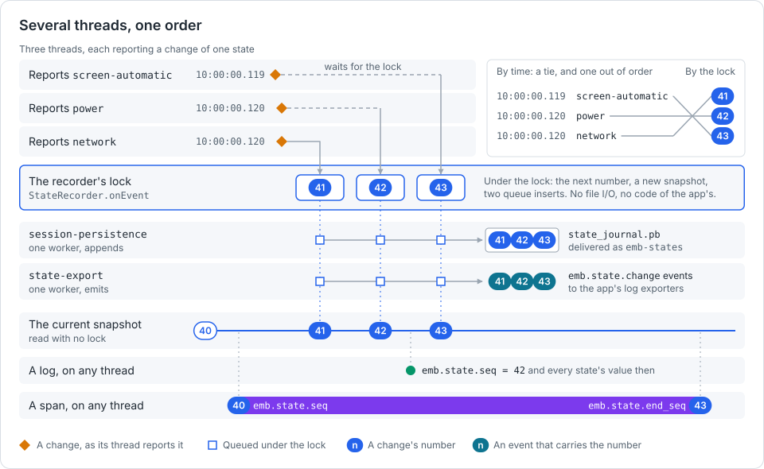
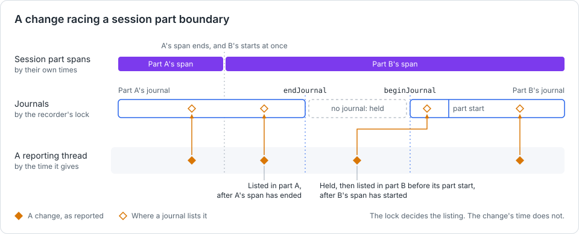
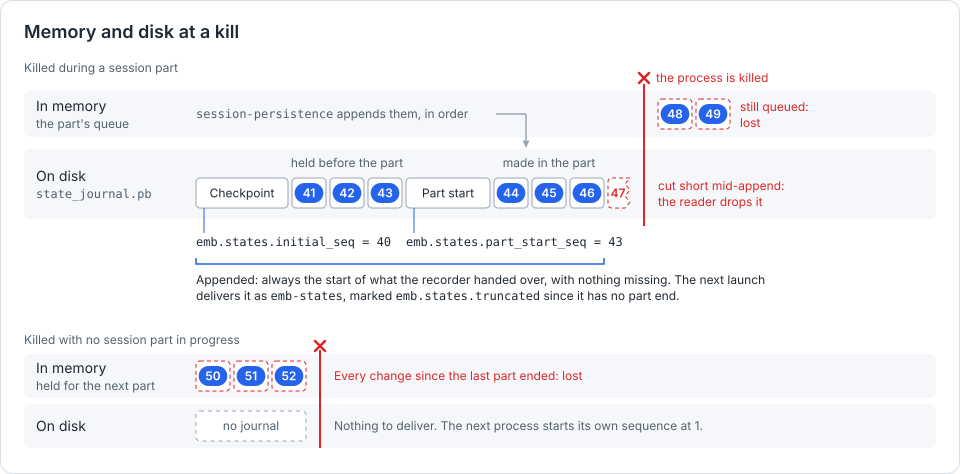
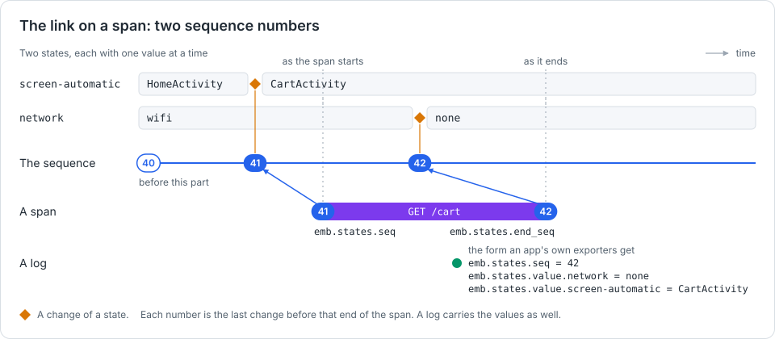
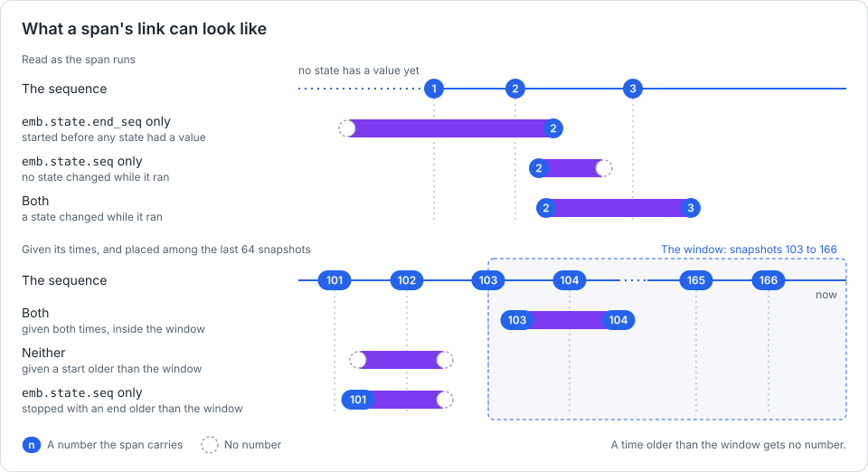

> AI Influence Level: [AIL 4, AI Created, Human Basic Idea](https://danielmiessler.com/blog/ai-influence-level-ail) · last judged 2026-11-25

# State capture: the Android design

**TL;DR:** How state capture works in the Android proof of concept, written to be checked beside its code: the
issues it overcomes, each mechanism with its class and its test, the invariants, the limits, what is not built, what
is known to be wrong, and where the build stands on every requirement.

## What this is, and its status

State capture records named conditions of the environment an app runs in: the network, power saving, the current
screen. Each has one value at a time, and telemetry is read against them. What ships today, v1, gives each state a
live span of its own in each session part. This document specifies the design that replaces it on Android, as a
proof of concept has built it. It covers Android only. What the SDK sends is called v2 here, and an internal
document, the cross-SDK model, specifies it for every Embrace SDK.

### The two steps

The proof of concept was built in two steps. Each is behind a switch that is off by default, and the second works
only where the first is on. Both also need multi-file persistence and v1's own switch.
[Configuration](#configuration) has the settings, their remote config keys and the exact conditions. This document
describes both steps as one design.

| Step | What it turns on |
|---|---|
| **1. The journal** | One recorder orders every change of every state and holds every value. Each change is appended to a journal file that travels with the session part, and the journal is delivered as one span, `emb-states`, the change log. Each log is stamped with one packed string, which both readers of a log see. |
| **2. Association** | The stamp on a log is split by reader: Embrace's payload keeps the packed string, and an app's own log exporters and processors get one attribute for each state, built only if the app has one. Each span carries a link of up to two sequence numbers, and a window of the recorder's last 64 snapshots places a span that is given its times. An app's own OpenTelemetry exporters get one of two renderings, association only or verbose, with change and snapshot events, or neither. |

### Status

- **It is a proof of concept**, built to find out whether the design holds. It is not shippable as it is. Once the
  specification is settled, it is rebuilt or hardened into something that ships.
- **Built and tested:** the recorder, the journal file with its writer and reader, the change log as one span, both
  forms of the stamp on logs, the link on spans and on their snapshots, the window of recent snapshots, and both
  renderings for an app's own exporters with their events.
- **Not built, known to be wrong, or not tested:** [what is not
  built](#what-is-not-built-and-what-is-known-to-be-wrong) has the lists, and [what it costs](#what-it-costs) has
  what was measured.
- **Not yet reviewed by an Android SDK engineer outside this work.**

### How to read this beside the code

- **The code is in a draft pull request** on `embrace-io/embrace-android-sdk`: https://github.com/embrace-io/embrace-android-sdk/pull/5050. Line numbers here
  are those of the code this document was last checked against.
- **Each mechanism names the class and function that does it**, and the test that shows it. A test is written as
  its class and its name in backticks, once, where what it tests is set out. Elsewhere it is named by its class
  and a few words, with a link to that place. A claim with no test says "not tested".
- **Each number says where it comes from**: a constant in the code or a test. A figure with neither beside it comes
  from internal measurement notes, and [how to run it](#how-to-run-it) names what reproduces it.
- **Requirement numbers (T1, P2, C4 and so on) are those of an internal requirements document.**
  [Acceptance](#acceptance-every-requirement) lists all 60.
- **Where this document and the code disagree, the code is right** and this document needs fixing.

### Words used here

- **An update** is one report of a state's value. **A change** is an update that gives the state a value it did not
  have. Only a change takes a number.
- **The sequence** is the count of changes in this process, across every state. It starts at 1.
- **A snapshot** is every state's value at one moment, with the sequence number of that moment. It is never
  modified once made.
- **A record** is an entry in the journal file. **A checkpoint** is the record a journal opens with: every state's
  value as of a sequence number.
- **Held** changes are those made with no session part in progress, kept in memory for the next part's journal.
  **Folded** changes are held changes that were applied to the checkpoint and are no longer listed.
- **The change log** is the journal as it is delivered: the span `emb-states`.
- **The stamp** is what a log carries of state: the packed form is one string, and the plain form is one attribute for
  each state. **The link** is the sequence numbers a span carries, up to two.
- **The window** is the recorder's last 64 snapshots, each with the time it took effect.
- **A rendering** is what an app's own OpenTelemetry exporters and processors are given: association only, verbose,
  or neither.

### A map of the code

Every path below is under `<module>/src/main/kotlin/io/embrace/android/embracesdk/`, written `<module>/…/`. Unit
tests are beside each module's code under `src/test`. The integration tests are in
`embrace-android-sdk/src/integrationTest/kotlin/io/embrace/android/embracesdk/testcases/features/`.

| File | What it holds |
|---|---|
| `embrace-android-instrumentation-api/…/internal/arch/datasource/StateUpdate.kt` | `StateUpdate`: a state's name, its value, when it took that value, and attributes of the change. `StateUpdate.KEY` is the event bus channel. |
| `embrace-android-instrumentation-api/…/internal/arch/datasource/StateDataSource.kt` | v1's data source. When the journal is on, it holds no span and emits a `StateUpdate` for each change of value (`journalUpdate`). |
| `embrace-android-infra/…/internal/utils/event/EventBus.kt` | The event bus. `emit` runs each handler on the calling thread. |
| `embrace-android-core/…/internal/capture/state/StateRecorder.kt` | The recorder: the one lock, the sequence and every state's value. |
| `embrace-android-core/…/internal/capture/state/StateSnapshot.kt` | The snapshot, and its two forms for a stamp: `encoded` (the packed string, which Embrace's payload gets) and `attributes` (one for each state, which an app's exporters get). |
| `embrace-android-core/…/internal/capture/state/StateChangeListener.kt` | What the recorder tells of each change and each part start, under its lock. |
| `embrace-android-core/…/internal/capture/state/StateEventEmitter.kt` | The listener that turns changes and part starts into events for an app's exporters. |
| `embrace-android-core/…/internal/capture/state/StateJournalSpan.kt` | `withStateSpan`: renders a part's journal as the `emb-states` span when the part is read. |
| `embrace-android-core/…/internal/capture/state/MetadataStates.kt` | `reportPersonasAsState`: the user's personas reported as a state, as a demonstration. |
| `embrace-android-session-persistence/src/main/proto/embrace/session/persistence/state_journal.proto` | The journal's records: `StateJournal`, `StateRecord`, `StateCheckpoint`, `StateChange`, `StatePartStart`, `StatePartEnd`, `StateValue`. |
| `embrace-android-session-persistence/…/internal/session/persistence/StateJournalWriter.kt` | Appends records to `state_journal.pb`. |
| `embrace-android-session-persistence/…/internal/session/persistence/StateJournalReader.kt` | Reads the journal back. |
| `embrace-android-session-persistence/…/internal/session/persistence/SessionPartDecoder.kt` | Reads a part's files. `readStateJournalFile` reads the journal, and a journal that cannot be read never fails the part. |
| `embrace-android-session-persistence/…/internal/session/persistence/SessionPartLimits.kt` | `MAX_PART_FILE_BYTES` and `MAX_RECORD_BYTES`. |
| `embrace-android-core/…/internal/session/orchestrator/SessionPartWriterImpl.kt` | Owns a part's files, and begins and ends the recorder's journal at a part boundary. |
| `embrace-android-core/…/internal/session/orchestrator/TelemetryWriteScheduler.kt`, `OrderedTelemetryQueue.kt` | The queue between the recorder and the persistence worker. |
| `embrace-android-core/…/internal/resurrection/SessionPartReader.kt` | Reads a part for delivery, calls `withStateSpan` (`SessionPartReader.kt:175`), and resurrects a dead part. |
| `embrace-android-sdk/…/internal/injection/OtelSignalContext.kt` | `getEventMetadata`: the metadata every log carries. It leaves state out where association is on, and gives the packed stamp where it is not. |
| `embrace-android-otel/…/internal/otel/logs/EmbraceLogRecordProcessor.kt` | Stamps each log by who reads it: the packed form into Embrace's payload, then the plain form onto the record if the app has a log receiver. Gives a log about another process none. Routes a state event past Embrace's payload. |
| `embrace-android-otel/…/internal/otel/state/StateStamp.kt`, `StateAttributes.kt`, `StateAssociation.kt` | What the OpenTelemetry module sees of a snapshot, the attribute and event names, and the seam the SDK module fills in. |
| `embrace-android-otel/…/internal/otel/state/SpanStateTracker.kt`, `SpanStateLink.kt` | The link on a span, and the decorated spans an app's exporters are handed. |
| `embrace-android-otel/…/internal/otel/state/StateSpanProcessors.kt` | `StateDecoratingSpanProcessor` wraps an app's span processor. `SpanStateReleaseProcessor` lets go of what was kept for a span. |
| `embrace-android-otel/…/internal/otel/state/StateEventLogger.kt` | Emits a state event through the logging pipeline with a context that marks it. |
| `embrace-android-otel/…/internal/otel/spans/EmbraceSpanProcessor.kt`, `EmbraceSpanFactoryImpl.kt`, `DefaultSpanExporter.kt` | Where the tracker is called. |
| `embrace-android-otel/…/internal/otel/logs/DefaultLogRecordExporter.kt`, `…/otel/payload/LogMapper.kt` | `exportInline` stores a log for Embrace's payload with the packed attributes added to the stored copy. `exportExternally` hands a state event to an app's log exporters only. |
| `embrace-android-otel/…/internal/otel/config/OtelSdkConfig.kt` | Builds the tracker, the decorators and the Resource from a `StateAssociation`. |
| `embrace-android-sdk/…/internal/instance/RealSdkInstanceFactory.kt` | The wiring: reads the switches (lines 179 to 198) and creates the recorder and the emitter (lines 350 to 374). |
| `embrace-android-config/…/internal/config/resolved/AutoDataCaptureConfig.kt`, `ConfigResolver.kt`, `StateExportMode.kt` | The settings, and `StateExportMode.defaultFor`. `embrace-android-payload/…/internal/config/remote/RemoteConfig.kt` has the remote keys. |

## The issues it overcomes

### What v1's design cannot do

The evidence is v1's code. What v1 was measured to cost is under [what it costs](#what-it-costs).

| What v1 cannot do, and where its code shows it | What answers it here |
|---|---|
| **Order changes across states.** Each state has a span of its own, and `StateDataSource.onStateChange` replaces `currentState` and then records the event through the part's token, as two steps with no lock around them (`StateDataSource.kt:110` to `135`). | One lock and one sequence: [the recorder](#the-recorder) |
| **Give a log values of one moment.** `InstrumentationRegistryImpl.getCurrentStates` reads each data source in turn, so two states that change during the read can be mixed. | One immutable `StateSnapshot`, read once for a log: [the snapshot](#the-snapshot) |
| **Record a change with no session part.** With no token, a change is counted and thrown away: `unrecordedTransitions.updateNotInSession(1)` (`StateDataSource.kt:151`). It is sent as the count `emb.state.not_in_session`. | Held changes, which open the next part's journal: [the journal](#the-journal) |
| **Keep more than 100 changes of a state in a part**, or 1,000 for the screen. `DEFAULT_MAX_TRANSITIONS = 100` in `StateDataSource.kt`, and `MAX_NAVIGATION_STATE_TRANSITIONS = 1000` in `NavigationStateDataSource.kt`. The rest are counted in `emb.state.dropped_by_instrumentation`, and the span has no final value. | A ceiling of 10,000 for a journal, shared by every state: [the journal](#the-journal) |
| **Cost nothing for a state that did not change.** `onPreSessionEnd` and `onPostSessionChange` stop and start a span for each state at every part change. Each state span that ends gets two links from the session part span and one back to it (`CurrentSessionPartSpanImpl.kt:151` to `176`). | A data source does nothing at a part boundary, and an idle state is one value in the journal's checkpoint: [reporting a state](#reporting-a-state) |
| **Persist a change at a cost that does not grow.** A span in progress is persisted by writing the whole span again, `SPAN_SNAPSHOT_WRITE_DELAY_MS` (2,000 ms) after a change. | An append-only journal: [the journal](#the-journal) |
| **Keep its links in a busy part.** The session part span holds 100 system links (`OtelLimitsConfig.getMaxSystemLinkCount`), and state spans end last. | One `STATE` link, added in `withStateSpan` when the part is read: [delivering a part](#delivering-a-part) |
| **Lose less than 2 seconds on a kill.** The same 2,000 ms delay. | A record is queued to the persistence worker at once, with `WriteStrategy.IMMEDIATE`: [the journal](#the-journal) |
| **Say anything about state on other spans.** `StateDataSource` writes to its own span and to nothing else. | `emb.states.seq` and `emb.states.end_seq`: [the link on spans](#the-link-on-spans) |
| **Track metadata one way.** Personas are in the envelope's metadata as their latest value. | Anything reports a state by emitting a `StateUpdate`, as `reportPersonasAsState` does: [reporting a state](#reporting-a-state) |
| **Keep a change's value when the change has many attributes of its own.** A change's own attributes are written before `emb.state.new_value`, and an event keeps its first 10. Read from the code, not seen happening. | A change keeps 7 attributes of its own, and none under a key the SDK uses (`StateRecorder.limited`): [the recorder](#the-recorder) |

### Traceability

| Issue | Mechanism | Set out, with its code and its test, under |
|---|---|---|
| One order across states and threads | One lock, one sequence, in `StateRecorder.onEvent` | [The recorder](#the-recorder) |
| One current value, and values of one moment | An immutable snapshot, replaced whole | [The snapshot](#the-snapshot) |
| A log's stamp agrees with the history | The stamp carries the snapshot's sequence, in both forms | [The stamp on logs](#the-stamp-on-logs) |
| A change keeps its reporter's time | `StateRecord.time_ms` is `StateUpdate.timeMs`, apart from `sequence` | [The recorder](#the-recorder) |
| Generated values are told apart | `StateValue.system`, from `SchemaType.State.valueType` | [The recorder](#the-recorder) |
| A change's attributes cannot displace its value | 7 attributes of its own, none under a key the SDK uses, in `StateRecorder.limited` | [The recorder](#the-recorder) |
| Anything can report a state | `StateUpdate` on the event bus | [Reporting a state](#reporting-a-state) |
| A change at a part boundary | Boundaries take the recorder's lock | [Session part boundaries](#session-part-boundaries) |
| No session part | Held changes, then folding, in `StateRecorder.hold` | [The journal](#the-journal) |
| The process dying mid-write | A prefix on disk, three places that stop, a mark | [The journal](#the-journal), [the process ending](#the-process-ending) |
| Nothing waits for a write | A queue insert under the lock, one worker | [The journal](#the-journal) |
| A cost that does not grow with changes | Append only, in `StateJournalWriter.writeImpl` | [The journal](#the-journal) |
| A cost that does not grow with states | A checkpoint, a shared stamp, two numbers | [Session part boundaries](#session-part-boundaries), [the stamp on logs](#the-stamp-on-logs), [the link on spans](#the-link-on-spans) |
| Limits that do not lie | Counts, final values, a mark | [Every limit](#every-limit) |
| A span read against state | Two numbers, of which a span carries both, one or neither | [The link on spans](#the-link-on-spans) |
| A span that is given its times | The window of 64 snapshots | [The link on spans](#the-link-on-spans) |
| Values for an app's exporters only | Decorated spans, a marked context | [What an app's own exporters get](#what-an-apps-own-exporters-get) |
| A slow processor of the app's | A worker of its own, a bounded queue | [What an app's own exporters get](#what-an-apps-own-exporters-get) |
| Off by default | Two switches, and v1's | [Configuration](#configuration) |

## The design in one picture



The same route as a map, with the class and function at each step:

```text
  what reports a state (any thread)                          session orchestrator (its own lock)
  StateDataSource.journalUpdate, reportPersonasAsState       SessionPartWriterImpl.onSessionPartStarted / Ended
          |                                                             |
          |  StateUpdate, on EventBus (the handler runs on              |  beginJournal / endJournal
          v  the thread that emitted it)                                v
  +--------------------------------- StateRecorder: one lock -----------------------------------------+
  |  sequence + 1     current = new StateSnapshot     recent: last 64     held: up to 1,000     opening |
  +-------+--------------------+----------------------------+---------------------------+-------------+
          | journal(records)   | listener (step 2,          | snapshot()                | snapshotAt(time)
          | under the lock     | under the lock)            | no lock                   | no lock
          v                    v                            v                           v
  OrderedTelemetryQueue   StateEventEmitter            EmbraceLogRecordProcessor   SpanStateTracker
          |               queue, up to 1,000           .onEmit                     .onStart / .onEnding
          | session-           | state-export               |                           |
          v persistence        v worker                     v                           v
  StateJournalWriter      StateEventLogger             the stamp on every log,     emb.states.seq and
  state_journal.pb        emb.states.change            by who reads it             emb.states.end_seq
          |               emb.states.snapshot                                       on the span itself
          | when the part      |                                                        |
          v is read            +-> the app's log processors (state-export worker)       +-> Embrace's payload:
  readStateJournal             +-> the app's log exporters (emb-otel-export thread)     |   the two numbers
  withStateSpan                    never Embrace's LogSink                              +-> the app's exporters:
  emb-states, in the                                                                        the numbers, and the
  part's envelope                                                                           values if verbose
```

### The path of one change

The network goes from wifi to none while a session part is in progress. Both switches are on.

1. `NetworkStateDataSource.onNetworkConnectivityStatusChanged` calls `StateDataSource.onStateChange` with the new
   value and `clock.now()`.
2. `StateDataSource.journalUpdate`, under the data source's `journalLock`, emits a `StateUpdate` on the event bus,
   and `EventBus.emit` calls `StateRecorder.onEvent` on the same thread.
3. `onEvent` does what the picture shows under the lock, and the reporter returns. No file has been touched, and no
   code of the app's has run.
4. From then on a log emitted on any thread carries the network as `none` in its stamp, packed as `network=none` in
   Embrace's payload and as `emb.states.value.network=none` for an app's log exporters, and the new `emb.states.seq`.
   A span that starts carries the new `emb.states.seq`, and one already running carries it as `emb.states.end_seq`
   when it ends.
5. When the part is read for delivery, `withStateSpan` renders the journal as `emb-states`, with this change as an
   event named `emb-state-network`.

### The threads

| Thread | What it does for state | What it can wait on |
|---|---|---|
| Whatever reports a state. Power saving reports its first reading, if power saving is on, from the `non-io-reg` worker, and each change after it from `PowerSaveModeReceiver.onReceive`, which is registered with no handler and so runs on the main thread. The network and the screen report on whichever thread their source calls them on, which was not traced. | `StateDataSource.journalUpdate`, then `StateRecorder.onEvent` in full: the comparison, the sequence, the snapshot, two queue inserts and up to two submissions to workers | Its data source's `journalLock`, and the recorder's lock. No I/O, and nothing of the app's. |
| Whatever changes the session part, on the main thread. | `SessionPartWriterImpl.onSessionPartStarted` and `onSessionPartEnded`, which call `beginJournal` and `endJournal` | The orchestrator's lock, the writer's `bufferLock`, the recorder's lock. No I/O. |
| `session-persistence`, one thread (`WorkerThreadPoolImpl.kt:106`) | Every append to the journal, and sealing a part | The disk |
| The worker that reads parts for delivery. When a part's writes complete, the read is submitted to `io-reg` (`createSessionOrchestrator` in `UserSessionOrchestrationFactories.kt`). | `readStateJournal`, then `withStateSpan` | The disk, and intake |
| `state-export`, one thread, used for nothing else | `StateEventEmitter.emitPending`: builds each event and emits it. The app's log record processors run here. | The app's log record processors, for as long as they take |
| `emb-otel-export`, one thread, `ExternalExportDispatcher` | Calls the app's span exporters and log exporters, for state events as for everything else | The app's exporters |
| Whatever starts or ends a span | `SpanStateTracker.onStart` and `onEnding`: one volatile read, at most a scan of 64 references, a put or a remove in a `ConcurrentHashMap` | Nothing |
| Whatever emits a log | `EmbraceLogRecordProcessor.onEmit`: one volatile read. The first log after a change builds the packed string, and the snapshot's attributes if the app has a log receiver. | Nothing |

### The locks

| Lock | What it guards | Held while |
|---|---|---|
| `StateRecorder.lock` | Every field [the recorder](#the-recorder) lists under `lock`, and every write to `current` and `recent` | The journal callback (a queue insert and a submission), the listener (a queue insert and at most a submission), and `onChangeDropped` (a call to `InternalTelemetryService.trackAppliedLimit`). |
| `StateDataSource.journalLock`, one for each data source | That the last update a state emits is the value it holds | `outgoingValueAttributes`, and the whole of `StateRecorder.onEvent` |
| The lock inside `reportPersonasAsState` | The same, for personas | Reading the user's personas, and the whole of `StateRecorder.onEvent` |
| `SessionPartWriterImpl.bufferLock` | Which part is current | `beginJournal` and `endJournal` |
| `OrderedTelemetryQueue.drainLock` | One drain of the part's queue at a time | Taking the queued records out. Not the write itself, which only the one worker makes. |
| `StateEventEmitter.drainLock` | One pass over the waiting events at a time | Building and emitting each event, the app's log record processors included |

- **The order they are taken in:** the orchestrator's lock, then `bufferLock`, then the recorder's. A reporter
  takes its own lock, then the recorder's. Nothing called under the recorder's lock takes another lock named here.
  Whether `trackAppliedLimit` takes one was not checked.
- **What reads without a lock:** `StateRecorder.snapshot` and `snapshotAt`. `StateRecorderTest` `a past snapshot is
  read without waiting for a change that is being recorded` holds the lock on one thread and reads both on another.

## Each part in depth

### Reporting a state

A state is reported by emitting a `StateUpdate` on the event bus: the state's name, its value, the time it took
that value, and any attributes of the change. The recorder decides whether the update is a change.

- **The channel is `StateUpdate.KEY`.** `EventBus.emit` runs every handler on the thread that emitted, in the order
  they were registered. The recorder is the one handler, registered in `RealSdkInstanceFactory.kt` as it is
  created. An event key retains nothing, so an update emitted before the recorder is registered, or after
  `EventBus.stop`, is not recorded.
- **A handler that throws does not reach the reporter.** The bus catches it and tracks
  `SdkErrorType.EventBusHandlerFail`, once for a handler.
- **`StateDataSource` reports for the three states v1 has.** Its `journaled` flag is true where
  `sharedStateSpanEnabled` and multi-file persistence are on. `onStateChange` then goes to `journalUpdate` and no
  span is made. `onPreSessionEnd` and `onPostSessionChange` return at once, so a data source does nothing at a part
  boundary.
- **A state's default is its first update.** `StateDataSource.startStateCapture` emits the default value when data
  capture is enabled, unless `captureStateOnCreation` is false. So the network is present as `unknown`, and the
  screen as `Initializing`, which is marked as generated, from the moment their instrumentation starts. Power
  saving sets `captureStateOnCreation` to false and reports nothing until power saving is first switched on
  (`PowerStateDataSource.onPowerSaveModeChanged`), so until then the recorder has no state `power`.
- **An update that leaves the value as it was is not emitted.** `journalUpdate` counts it, with any transitions the
  instrumentation said it dropped, and attaches the count to the next change as
  `emb.state.dropped_by_instrumentation`, put first so that it is not the attribute cut. It is the one key under
  `emb.state.` that a change's own attributes may carry, and only the data source sets it: a reporter's value under
  that key is replaced by the count, or removed where there is none. `StateDataSourceTest` `a journaled state emits
  each change of value and counts the transitions it did not emit`, and `a reporter cannot set the count of
  transitions the instrumentation dropped on a journaled change`.
- **A change away from a value carries what is known of that value.** The result of `outgoingValueAttributes` for
  the value being left goes on the change. The screen uses it for the dropped and expected frame counts
  `VitalsDataSource` kept while that screen was showing.
- **v1's limit for each state is not applied.** `journalUpdate` does not pass through the data source's limit
  strategy, so a journaled state is held only to the journal's shared ceiling.
- **Personas are reported as a state, as a demonstration.** `reportPersonasAsState` reports the user's personas,
  sorted and joined by commas, once at start and again whenever the user's information changes, with no data
  source and no span. It is wired wherever the recorder exists (`RealSdkInstanceFactory.kt:886`), with no switch of
  its own. So with the first switch on every log and every change log carries a state named `personas`, with an
  empty value for a user with none. The first test of `StateJournalFeatureTest`, under [the stamp on
  logs](#the-stamp-on-logs), delivers it.

What a reporter has to get right:

- **Hold a lock across reading the value and emitting it.** If two threads interleave those two steps, the older
  value can be emitted last and stay on every log until the next change. `StateDataSource.journalLock` and the lock
  in `reportPersonasAsState` do this. `StateDataSourceTest` `every update a journaled state emits is the value it
  holds as it is emitted` checks the first.
- **Give the time the value took effect**, which can be earlier than the report. The recorder keeps it and does not
  order by it.
- **Expect to be held for as long as the recorder's lock is.**

### The recorder

`StateRecorder` is the only thing that decides what a change is, what number it has, and what every state's value
is. It is created only where the journal is on, with `keepRecent` set where association is on.

| Field | What it is | Guarded by |
|---|---|---|
| `sequence` | The number of the last change. 0 until the first. | `lock` |
| `current` | The `StateSnapshot` of now. Starts as `StateSnapshot.NONE`: sequence 0, no values. | Written under `lock`, volatile, read without it |
| `recent` | The last 64 snapshots, oldest first, `current` last. Empty unless `keepRecent`. An array that is replaced by a copy and never written to. | Written under `lock`, volatile, read without it |
| `journal` | The callback that takes the records of the part in progress. Null with no part. | `lock` |
| `opening`, `openingTimeMs` | The values the next journal opens with, and when they held | `lock` |
| `held` | The changes made since `opening`, oldest first | `lock` |
| `folded` | How many changes were folded into `opening` since the last journal ended | `lock` |
| `recorded`, `dropped` | How many changes the journal in progress holds, counting those it opened with, and how many it does not | `lock` |

What `onEvent` does, in order:

1. **Outside the lock:** the value becomes text with `toString`, cut to 2,000 characters. It is generated,
   `system`, if the value object is a `SystemStateValue` (`SchemaType.State.valueType`).
2. **Under the lock, the comparison.** If the state already has that text and that `system` flag, the update is not
   a change and `onEvent` returns. A state's first value is always a change.
3. **The number and the snapshot.** `sequence` goes up by one. `current.with` copies the map of every state's value
   with the new value in place, and the copy becomes `current`. With `keepRecent` the copy also notes `clock.now()`
   as `sinceMs`, and `remember` adds it to `recent`, dropping the oldest past 64.
4. **The ceiling.** If a journal is open and `recorded` has reached `maxChanges`, the change is counted in
   `dropped`, `onChangeDropped` is called, and `onEvent` returns. The snapshot was already replaced, so the values
   stay right. The listener is not told.
5. **The record.** A `StateRecord` is made with the sequence, the reporter's time, the value, and the change's
   attributes after `limited`.
6. **The journal or the hold.** With a journal open, `recorded` goes up and the record is handed to the callback.
   With none, `hold` keeps it.
7. **The listener.** `listener.onChange` is told the record, the snapshot that change produced, and the value the
   state had before, which is null for its first change.

What follows from that:

- **Two times.** A record's `time_ms` is when its reporter says the change happened, and is what the change log
  carries. A snapshot's `sinceMs` is when the recorder recorded it, by the SDK's clock, and is what the window is
  searched by. A change reported late has a `sinceMs` later than its `time_ms`. `StateJournalSpanTest`'s test of a
  part that ended, under [delivering a part](#delivering-a-part), checks the `time_ms` of a change held from before
  the part and of one made in it.
- **Two values that differ only after their 2,000th character are the same value**, since the comparison is of the
  cut text. Not tested.
- **A state never leaves the snapshot**, and nothing gives it no value.
- **The map is copied for every change.** That is what makes a snapshot safe to read with no lock, and it grows
  with the number of states. [What it costs](#what-it-costs) has the count.
- **The clock is read once for a change with association on, and not at all with it off.** `StateRecorderTest` `a
  recorder that remembers nothing does not read the clock for a change, and knows no past snapshot`.
- **A change's attributes are limited by `limited`:** the first 7 in the order the reporter gave them, each key cut
  to 1,000 characters and each value to 2,000. The 7 is `OtelLimitsConfig.getMaxEventAttributeCount`, which is 10,
  less the three an event is given for the value, its type and its number. Nothing says an attribute was left out.
  `StateRecorderTest` `a value or an attribute longer than a span event could carry is cut short`.
- **A change's own attribute under `emb.states.` or `emb.state.` is dropped,** before the count, so it uses up none
  of the 7. The one exception is `emb.state.dropped_by_instrumentation`. So no reporter can set a key the SDK writes
  on a change, in the change log or in an event for an app's exporters. A key outside the stems, such as `emb.type`,
  is kept in the change log, and an event has the SDK's value for each key the SDK writes. `StateRecorderTest` `a
  change's own attribute under either state stem is dropped, and uses up none of the seven a change can carry`.
- **A state's name is not validated, cut or escaped.**

### The snapshot

`StateSnapshot` is the sequence number of one moment, every state's `StateValue` at that moment in the order the
states were first reported, and `sinceMs`. Everything read from one instance describes the same moment.

- **`encoded`** is the packed form, the one Embrace's payload carries: `name=value` for each state, joined by `;`. A
  generated value is written `name~value`. A `;`, `=`, `~` or `\` inside a name or a value is preceded by `\`.
  Each value has been cut to 2,000 characters by the recorder before it is joined, so no cut can fall inside the
  string.
- **`attributes`** is the plain form, the one an app's own exporters get: `emb.states.value.<name>` for each state,
  and `emb.states.value_type.<name>` with the value `system` for a generated one.
- **`endAttributes(start)`** is each state whose value or `system` flag differs from `start`, as
  `emb.states.end_value.<name>` and `emb.states.end_value_type.<name>`. It is empty where both snapshots share one
  map.
- **`encoded` and `attributes` are built the first time they are read and kept**, with
  `LazyThreadSafetyMode.PUBLICATION`. Two threads that read one for the first time together can both build it, and
  one result is kept. So everything stamped until the next change shares one string or one map. A snapshot's
  `attributes` are read for a log only where the app has a log receiver, and for an exported span in the verbose
  rendering.

`StateRecorderTest` `a snapshot marks system values and escapes what would break its encoding` and `a snapshot
gives every value as an attribute, says what differs from an earlier one, and when it was recorded` cover these.

### The journal

The journal is `state_journal.pb` in the session part's directory, beside `metadata.pb`, `completed_spans.pb` and
`span_snapshots.pb`. It is deleted with the directory once the part has been stored for delivery.

**The format.** The file is a run of encoded `StateJournal` protobuf messages, one after another, which is also one
valid `StateJournal`:

| In the file | Field of `StateJournal` | Written |
|---|---|---|
| The header | `format_version`, field 1. `FORMAT_VERSION` is 3, shared with the part's other files. | Once, with the first append |
| A record | `records`, field 2. One length-delimited `StateRecord`. | In each append, in the order the records were handed over |
| The time of the write | `written_at_ms`, field 3 | At the end of each append |

`StateJournalDecoder.read` walks the file one frame at a time by field number, and skips a field it does not know.

**The records.** Every `StateRecord` has a `sequence`, a `time_ms`, and exactly one of four bodies:

| Record | `sequence` | `time_ms` | Body |
|---|---|---|---|
| Checkpoint | The number the values are as of | When those values held: the end of the last part, or the time of the last change folded in, or when the recorder was created | `values`: every state's name, value and `system` flag |
| Change | The change's own number | When its reporter says it happened | `value`: the state's name, new value and `system` flag. `attributes`: the change's own. |
| Part start | The number of the last change before the part | When the part started | `dropped_changes`: how many changes were folded into the checkpoint |
| Part end | The number of the last change made, recorded or not | When the journal was ended | `dropped_changes`: how many changes the journal did not record. `values`: every state's value, only if that count is above 0. |

A journal holds, in this order, one checkpoint, the changes held from before the part, one part start, the changes
of the part, and one part end if the part ended in the process that started it. The changes are consecutive from
the number after the checkpoint's.

**The writer.** `SessionPartWriterImpl` owns the file, as it owns a part's other files.

- **Each part has its own queue.** `PartWriters.stateJournalWrites` is a `TelemetryWriteScheduler` over an
  `OrderedTelemetryQueue`, with no delay. The recorder's journal callback calls `write(WriteStrategy.IMMEDIATE,
  records)`, which adds the records to the queue and submits a write task to the `session-persistence` worker.
- **A write task drains everything queued** and calls `StateJournalWriter.write` once with it. So a burst is often
  one append, and a task that finds the queue already drained does nothing. A task is still submitted for every
  change, which wakes the worker each time.
- **`StateJournalWriter.writeImpl` appends** the header if the file is empty, then one `StateJournal` holding the
  records that fit and the time of the write. `SpanCollectionFile.append` writes to a `FileOutputStream` opened for
  appending and kept open for the part. Nothing already in the file is rewritten: `StateJournalWriterTest` `earlier
  bytes are never rewritten`. So a change appends about 47 bytes, however many came before:
  `StateCapturePayloadSizeTest` `persisting a change to the journal costs the same however many changes came before
  it`.
- **The file is never synced.** A write that returned survives the process dying, and is not guaranteed to survive
  the device losing power. Not tested.

**The order guarantee.** What is on disk is always the start of what the recorder handed over, with nothing missing
from the middle. Four things make that so:

1. **Records enter the queue in sequence order**, because the callback runs under the recorder's lock.
2. **One thread appends them** in the order they were queued.
3. **The writer stops at the first record it cannot append.** `recordsThatFit` takes records from the front until
   one would take the file past `MAX_PART_FILE_BYTES` (12 MB) or is itself larger than `MAX_RECORD_BYTES` (1 MB).
   After that, or after a write that throws, `stopped` is set and every later record for that part is refused, even
   one that would fit. `StateJournalWriterTest` `nothing is journaled after a record that is too large`, `nothing
   is journaled after the journal fills up even if it would fit` and `nothing is journaled after a write fails`.
4. **The reader stops at the first record it cannot read.** A record cut short by a process that died is not an
   error, and the records before it are kept. A record that is all there and does not decode is reported, and
   reading stops. `StateJournalReaderTest` `a record cut short by a process that died is not an error` and `reading
   stops at a record that does not decode and reports it`.

A fifth check sits behind them. `upToFirstMissingChange` in `StateJournalSpan.kt` cuts the delivered span at the
first change whose number is not one more than the change before it, and the span is marked: `StateJournalSpanTest`
`a journal with a change missing is delivered up to the missing change and marked`. Nothing known can produce such
a journal.

**The ceiling.** A journal holds at most `MAX_JOURNAL_CHANGES`, 10,000 changes, counting those it opened with from
before its part. A change past it is tracked through `InternalTelemetryService.trackAppliedLimit` as
`state_change`, as well as counted in `dropped`. The ceiling is one count shared by every state, so one state that
changes constantly can use it up. Each journal has the ceiling to itself. `StateRecorderTest` `a journal that
reaches its limit stops recording changes and still ends with the right values`.

**Held changes and folding.** With no journal open, `hold` keeps each change in `held`, up to `maxHeldChanges`,
which is the ceiling divided by `HELD_SHARE`: 1,000. One more than that, and the oldest held change is folded:

- **The checkpoint moves forward by one change:** the value is applied to `opening`.
- **The checkpoint's time moves with it:** `openingTimeMs` becomes that change's time.
- **It is counted:** `folded` goes up, and `onChangeDropped` is called, which tracks the same `state_change` limit.

So a long stretch with no part costs a bounded number of records, the next journal still leads from its checkpoint
to the present with no change missing, and the changes it lists are the ones nearest the part. `StateRecorderTest`
`more changes than are held for the next journal are folded into the values it opens with`.

**When a write fails or the file is full.** The writer stops, and tracks `SdkErrorType.StateJournalWriteFail`. The
recorder is not told. It goes on handing records over, counts them as recorded, and at the part's end hands over a
part end that the writer also refuses. So the journal on disk has no part end, and is delivered marked as cut
short, on a span that did end. How many changes it is missing, and the values at the end of the part, are not known
from it. If nothing of the first append lands, the part is delivered with no `emb-states` span, and nothing in the
payload says why.

### Session part boundaries

`SessionPartWriterImpl` starts and ends the recorder's journal, inside its own `bufferLock`, from the calls the
session orchestrator makes under its lock.

**A part starts.** `onSessionPartStarted` makes the part's directory and writers, then calls
`StateRecorder.beginJournal` with the part's start time, which is the transition's timestamp, and a callback that
queues to that part's writer. Under the recorder's lock, `beginJournal`:

1. **Ends any journal still open**, which should not happen.
2. **Hands over one list:** the checkpoint from `opening`, every held change, and a part start carrying `folded`.
   `StateJournalFeatureTest` `changes made with no session part in progress are delivered with the next part to
   start`.
3. **Counts the held changes towards the ceiling.** `recorded` is set to their number, and `held`, `folded` and
   `dropped` are cleared.
4. **Keeps the callback** as `journal`.
5. **Tells the listener**, through `onPartStart`, the part's start time and the current snapshot.

**A part ends.** `onSessionPartEnded` calls `StateRecorder.endJournal(clock.now())`, under the same `bufferLock` a
part starts under, so that it cannot end the journal of the part after this one. `endJournalUnderLock` hands over a
part end with the count of dropped changes, and with every state's value if that count is above 0. It then clears
`journal`, and keeps the current snapshot as `opening` and the end time as `openingTimeMs`. `SessionPartWriterImpl`
then flushes the part's queues and seals the part on the worker.



**What a reader can rely on at a boundary:**

- **A change is in exactly one journal.** It is in the journal that was open when the recorder's lock was taken for
  it, or held for the next: `SessionPartWriterImplTest` `state changes are journaled with the session part they
  were made in or the next to start`. `SessionPartWriterImplTest` `state changes racing session part changes are
  each journaled once and in order` runs 4 threads making 2,000 changes each while up to 100 parts start and end,
  and accounts for all 8,000.
- **Journals chain.** A journal's checkpoint has the sequence the last journal ended on, plus what was folded
  since. The same test checks it for every part.
- **"Before the part" means before the journal began, and not an earlier time.** The lock decides the listing, and
  a change's time does not. A held change usually has a time from before its part's span starts, but not at a
  boundary. Where a part follows, `CurrentSessionPartSpanImpl.endSession` stops the old session part span and
  starts the next in one call (`CurrentSessionPartSpanImpl.kt:185` to `214`), before the orchestrator calls
  `onSessionPartEnded`. So both spans change over before either journal call, as the picture draws it. The part
  start record carries the transition's timestamp, which was read before the spans changed over, and not the new
  span's start. A reporter's time can also be any time it gives. `StateKnownDefectsTest` `a change is listed by
  when it was recorded and not by its time, so an event can lie outside its span with no mark` shows it at the
  recorder, with times given by hand. No test makes it through the orchestrator.
- **A part that starts before the last one ended** is tracked as `SdkErrorType.SessionPartEndMissed`, and the open
  journal is ended first.
- **Two part changes at once are ordered by `bufferLock`.** The orchestrator makes one at a time, and no test makes
  two.

### Delivering a part

When a part is read to be delivered, `SessionPartDecoder.decode` reads its journal with the part's other files, and
`SessionPartReader.deliver` calls `withStateSpan` on the part's envelope with the journal's records. That adds one
span and one link. A part with no journal, or whose journal does not open with a checkpoint, is returned as it was.

| On the span | Where it comes from |
|---|---|
| Its name, `emb-states` | `SPAN_NAME`, with the prefix every span of the SDK's own gets |
| Its trace id and span id | `stateSpanIds`: a SHA-256 of `states:` and the part's `emb.session_part_id`. The first 16 bytes are the trace id and the next 8 the span id. If the part has no single session part span, or that span has no part id, the seed is the checkpoint's sequence and time. |
| Its parent | None. It is a root span in a trace of its own. |
| Its start | The session part span's start. Without that span, the part start record's time, or the checkpoint's. |
| Its end | The session part span's end, if that span completed. Otherwise the part end record's time. With neither, the span has no end and goes among the part's span snapshots. |
| Its status | Unset. A span left with no end is completed by resurrection as a failed span, like any other snapshot of a dead part. |
| `emb.type` | `state` |
| `emb.process_identifier`, `emb.session_part_id`, `emb.user_session_id` | Copied from the session part span |
| `emb.states.initial_value.<name>` | Each value in the checkpoint |
| `emb.states.initial_value_type.<name>` | `system`, for a generated value in the checkpoint |
| `emb.states.initial_seq` | The checkpoint's sequence |
| `emb.states.part_start_seq` | The part start record's sequence. If the journal stops before its part start, the sequence of its last change, or of the checkpoint if it has no change. |
| `emb.states.folded_changes` | The part start's count, if above 0 |
| `emb.states.dropped_changes` | The part end's count, if above 0 |
| `emb.states.final_value.<name>`, `emb.states.final_value_type.<name>` | The part end's values, which it has only when changes were dropped |
| `emb.states.truncated` | `true`, if the journal has no part end or was cut at a missing change |
| An event for each change, named `emb-state-<name>` | In the journal's order, with the record's time. Its attributes are the change's own, at most 7, then `emb.states.seq`, then `emb.states.new_value`, then `emb.states.new_value_type` as `system` for a generated value. |

- **Each event carries its number** as `emb.states.seq`, so a reader does not count from `emb.states.initial_seq`, and
  a gap in the numbers shows a missing change. The first event is the change numbered `emb.states.initial_seq` plus
  one, and each after it the next. Events up to `emb.states.part_start_seq` were listed before the part. A truncated
  change log's last event says the last number it recorded. [What it costs](#what-it-costs) has the number's bytes.
- **A span the dead process left running gets its end number here.** Where the part has no end, neither on the
  session part span nor in the journal, `withStateSpan(journal, completesRunningSpans)` gives each of the part's span
  snapshots, the session part span included, `emb.states.end_seq`: the last change the journal lists, if that is above
  the span's start number or the span has none. `SessionPartReader` asks for it where association is on, whatever the
  rendering. A cut-short journal's last number can be below what the dead process reached. `StateJournalSpanTest` `a
  span a dead process left running that started before the last change a journal lists is given that change as its
  end`.
- **Every state's value at a number** is the initial values with each event up to that number applied. That is how
  a reader resolves a span's link and checks a log's stamp. The integration tests do exactly this in `valuesAt`.
- **The link.** The session part span is given one link to the state span, with `emb.link_type` as `STATE` and the
  part's id. It is added here, so the limit on a live span's links does not apply.
- **The span is built outside the OpenTelemetry pipeline.** No processor or exporter of the app's ever sees
  `emb-states`. The limit the SDK puts on a live span's events, 2,000, does not apply to it either: it can carry
  10,000.
- **Every attribute value is text**, as in the rest of Embrace's payload.
- **`stateAttributes` in `StateJournalSpan.kt` writes the `emb.states.` attributes above**, and `changeEvent` each
  event.

**Reading a part twice gives the same span.** A part is read again if the process dies between storing its payload
and deleting its files. `withStateSpan` reads no clock and makes no random id: its output is a function of the
envelope and the journal, and its ids of the part's id. `StateJournalSpanTest` `the span covers its session part
and a part delivered twice delivers the same span` compares the ids of the two readings only. That the rest is the
same is read from the code.

`StateJournalSpanTest` has a test for each row above that depends on the journal's shape, from `a journal of a part
that ended is delivered as a completed span` to `a session part with no journal is delivered as it is`. Not tested:
the ids of a part with no single session part span, a start taken from the checkpoint's time, and a journal whose
first record is not a checkpoint.

### The process ending



| How the process ends | What the SDK does | What the journal holds | How it is delivered |
|---|---|---|---|
| The part ends normally | `endJournal`, then every queue is flushed and the part is sealed | Everything, with a part end | As a completed span, by the same process |
| A JVM crash | `SessionOrchestratorImpl.handleCrash` ends the part, which ends the journal. `SessionPartWriterImpl.onCrash` then flushes and waits up to `CRASH_DRAIN_TIMEOUT_MS`, 3,000 ms, for the worker. | Everything, with a part end, if the worker finishes in that time | By the next launch, as a completed span, not marked. `StateJournalFeatureTest` `changes made in a session part that crashed are delivered with it by the next launch`. |
| A native crash, a kill after an ANR, a low-memory kill, a force stop | Nothing | Every record the worker had appended, with nothing missing before the last. A record cut short mid-write is dropped by the reader. | By the next launch. The span has no end, so resurrection completes it as a failed span, and it is marked `emb.states.truncated`. Each span the part had running is given the journal's last number as `emb.states.end_seq`, where association is on and that number is past the span's own. Logs and spans can carry numbers above its last event. `StateJournalFeatureTest` `changes made in a session part the process was killed in are delivered with it by the next launch`. |
| Any of these with no session part in progress | Nothing | Nothing: the held changes are in memory only | They are lost. The next process has another identifier and starts its own sequence at 1. |
| The device loses power | Nothing | Not guaranteed. The journal is never synced. | Not tested |
| The SDK is stopped | `SessionPartWriterImpl.close` ends the journal and seals the part | Everything, with a part end | Not traced further here, and not tested |

- **After a JVM crash no new part is started**, so changes made while the process is still dying are held, and
  lost.
- **The kill in the tests is simulated.** The integration test stops the persistence workers and starts a second
  SDK on the same storage.

### The stamp on logs

`EmbraceLogRecordProcessor.onEmit` stamps a log with state, on the thread that emits it, by who reads the log. It
reads `StateRecorder.snapshot` once, so the values are all of one moment. Every log carries every state's value and
the sequence number to both readers, in two forms.

| Where | What a log carries | Built from |
|---|---|---|
| Neither switch on | v1's `emb.state.<name>`, one for each state, read from each data source in turn | `InstrumentationRegistry.getCurrentStates` |
| The first switch only | `emb.states.packed`, the packed string, and `emb.states.seq` as text, on the record, so that both readers see them | `StateSnapshot.encoded`, through `OtelSignalContext.getEventMetadata` |
| Both switches, Embrace's payload | `emb.states.packed` and `emb.states.seq` as text, added to the stored copy of the log | `StateSnapshot.encoded` |
| Both switches, an app's log exporters and processors, if it has one | `emb.states.value.<name>` for each state, `emb.states.value_type.<name>` as `system` for a generated value, and `emb.states.seq` as a whole number | `StateSnapshot.attributes` |

- **The order matters.** `onEmit` puts the metadata that is not state on the record, with `getEventMetadata` leaving
  state out where association is on. `DefaultLogRecordExporter.exportInline` then stores Embrace's payload from that
  record, and `LogMapper.toEmbracePayload` appends the packed attribute and the text number to the stored copy, unless
  the record has them. Only after that, and only if the app has a log exporter or a log record processor, which
  `OtelSdkConfig` works out once from what the pipeline is built with, are the plain attributes put on the record the
  app's processors and exporters are handed. Put on first, the payload would carry them too. The packed form cannot go
  on the record and come off for the app, since a record can only be added to. The record's attributes are read once,
  the number goes on before the values, and the packed pair is kept for every log between two changes.
  `StateAssociationTest` `a log carries the packed stamp into Embrace's payload and the plain one to an app's exporter
  and processor`, and `EmbraceLogRecordProcessorTest` `state is stamped on Embrace's payload as the packed attribute,
  and on the record as one attribute for each state`.
- **For an app with no log receiver, the plain form is never built for a log.** A span exporter alone does not
  count, though in the verbose rendering its exported spans read the same values. A test counts the reads of
  `StateSnapshot.attributes` and finds none: `StateAssociationTest` `with no processor or exporter of the app's for
  logs, Embrace's payload has the packed stamp and no plain one is built`, and `EmbraceLogRecordProcessorTest` `with
  nothing of the app's to receive a log the plain attributes are never built`.
- **The values are put together once for each change.** Writing each plain attribute onto the record still happens for
  every log where the app has a log receiver, and grows with the number of states. Embrace's payload gets one
  attribute however many states there are.
- **A log carries no stamp** before any state has a value, when it already has `emb.states.packed` (a record keeps
  an attribute of the stamp's name), or when it describes another process: a native crash's log, and any log that
  already names a session part, as the record of why the last process exited does, with an empty one. Such a log
  never gets this process's state, with association on or off, and getting the dead process's is [not
  built](#not-built). `EmbraceLogRecordProcessorTest` `no state is stamped when none has a value, or on a native
  crash or an exit record, or on a log with the packed attribute` and `a packed stamp the metadata supplies is left
  off a log about another process, and kept on an ordinary one`, and `StateAssociationTest` `an exit record about
  the last process carries none of this process's state, and an ordinary log carries both forms`.
- **With association on, a log can be stamped before `OtelSignalContext.markReady`.** The gate that kept state off a
  log until the end of SDK start was in `getEventMetadata`, which does not build the stamp. A log emitted between
  the recorder's creation and `markReady` can carry state and none of the session's ids. Personas are reported before
  `markReady` is called (`RealSdkInstanceFactory.kt:886` and `907`). Whether any log is emitted in that window was not
  traced. Not tested.
- **`StateExportMode.OFF` still gives a log the plain stamp,** where the app has a log receiver: the mode governs
  events and the values on spans, and not the stamp. A state event carries no stamp either: [what an app's own
  exporters get](#what-an-apps-own-exporters-get) has why.
- **The packed form passes none of the SDK's own limits and no redaction,** and the plain form is cut at 400
  attributes. The recorder cuts a value to 2,000 characters and does not cut a state's name. The packed attribute is
  added after the log is converted, so no limit cuts it: `StateAssociationTest` `many long states reach Embrace's
  payload whole in the packed stamp, which no limit on a log attribute cuts` sends 501 states, one of 5,000
  characters, and the whole string arrives. The plain form is on the record, under the OpenTelemetry SDK's limit of
  400 attributes (`attributeCountLimit`, `OtelSdkWrapper.kt:100`). The log's own attributes come first, then the
  number, then the values, and what does not fit is dropped with nothing to say so: with 501 states the number
  survives and the values are cut. `StateAssociationTest` `the plain stamp on what an app is handed is held to the
  limit on a log record's attributes`. No limit on the length of a log attribute is configured.
- **`emb.state` alone is still on every log.** It is the foreground or background attribute, and has nothing to do
  with this.

The stamp agrees with the change log: replaying the part's `emb-states` to the log's `emb.states.seq` gives the
log's values. `StateJournalFeatureTest` `changes of every state are delivered in the order they were made, as one
span of their session part`, the first test of its class, checks it for the packed string, and `assertEmbracePayload`
in `StateAssociationFeatureTest` checks Embrace's payload the same way. `assertExportedSpansAndLog` checks that the
plain attributes an app's exporter and processor get hold the same values as the packed string, and that the exported
log has no `emb.states.packed`. It holds as far as the change log of the log's part lists the changes. In these cases
a log carries a number its change log does not reach, and still has its own values. The last two are read from the
code, and not tested.

- **Past the ceiling, or after a kill.**
- **Once the writer has stopped.**
- **A log emitted with no session part in progress, or as a part changes**, can name one part and carry a number that
  only the next part's change log reaches. `onEmit` reads the session ids and then the snapshot, and nothing orders
  the two against a part boundary.

### The link on spans

With association on, `OtelSdkConfig` makes one `SpanStateTracker`, and `EmbraceSpanProcessor` calls it for every
span. The link is two attributes written on the span itself, so they reach Embrace's payload and an app's exporters
alike: `emb.states.seq`, and `emb.states.end_seq`.



**At the start.** `EmbraceSpanProcessor.onStart` calls `SpanStateTracker.onStart`:

1. `stampAt` finds the snapshot that held at the span's start time.
2. If none is known, the span is not linked: it gets no attribute, and nothing is kept for it.
3. Otherwise the span gets `emb.states.seq` as a whole number, unless that sequence is 0, and the tracker keeps a
   reference to the snapshot under the span's id, in `starts`.

**At the end.** `EmbraceSpanProcessor.onEnding` calls `SpanStateTracker.onEnding`, while the span can still be
written to. It is asked for only where there is a tracker: `isOnEndingRequired` is false with association off.

1. The end time is the one the span says, or the one it was given, or now.
2. `stampAt` finds the snapshot that held then. If none is known, the span keeps its start number and gets no end
   number.
3. The span gets `emb.states.end_seq` only if that snapshot's sequence is above the start's.

`SpanStateTrackerTest` `a span carries the number at its start, and the number at its end only if a state changed
while it ran`.

**Placing a time: `stampAt`.**

- **A time at or after the current snapshot's `sinceMs`** gets the current snapshot, since nothing has changed
  since it took effect. This is every span that starts or ends now, and it costs one read.
- **An earlier time** is looked up in the window. `StateRecorder.snapshotAt` scans `recent` from the newest,
  taking no lock, and returns the first snapshot whose `sinceMs` is at or before the time.
- **The window is 64 snapshots:** `RECENT_SNAPSHOTS`, the current one and the 63 before it. It begins holding
  `StateSnapshot.NONE`, whose `sinceMs` is 0. So until 64 changes have been made, any time before the first change
  resolves to "no state had a value". After that, a time older than the oldest snapshot kept is not known, and
  `snapshotAt` returns null. A span whose end cannot be placed carries no end number and no mark. That takes an
  app that records a finished span with times far in the past, after more than 64 changes since it ended.
- **The tie rule.** A time equal to the time a change was recorded counts as after that change, so where several
  changes were recorded in one millisecond the time gets the last of them. `StateRecorderTest` `the snapshot that
  held at a recent time is remembered, and a time further back than the last 64 is not known`. The rule holds as
  well for a span that reads the current snapshot: one that starts in the millisecond a change is recorded in,
  before the change, can get that change's number.

**A span that is given a time.**

- **A start time** is passed to the OpenTelemetry span as it starts, and `onStart` reads it from the span.
- **An end time** cannot always be read from a span that is ending. The Kotlin implementation of OpenTelemetry
  gives it, and the Java one does not until the span has ended, which is too late to write to it. So
  `EmbraceSpanImpl.endOtelSpan` tells the tracker the time first, through `SpanStateLink.onEndTimeGiven`, and the
  tracker keeps it in `givenEndTimes` until the `onEnding` that follows in the same call.
- **A span recorded once it is over** is given both, and gets both numbers this way.

`SpanStateTrackerTest` has a test for each: `a span given a start time from before the last change carries the
number that held then, if that is remembered`, `a span ended at a time from before the last change carries the
number that held then, and not the current one`, and `a span that is given both its times once it is over is linked
if the stamp at its start is remembered`. `StateAssociationTest` repeats them on both OpenTelemetry
implementations, the last two through the real span service, and `StateAssociationFeatureTest` `a span that is
given a time is linked to it only while the snapshot that held then is among the last 64` through the whole SDK.

**Span snapshots.** A span still running when its part ends is delivered as a snapshot, which is made from what
`EmbraceSpanImpl` holds and not from the OpenTelemetry span. So `EmbraceSpanImpl.start` asks the tracker for the
number the processor has just written, through `SpanStateLink.startSequence`, and keeps it among the span's own
attributes. A snapshot carries `emb.states.seq` and never an end number from the live process. The next launch adds
one: [delivering a part](#delivering-a-part). `StateAssociationFeatureTest` `a span in progress when its process
dies is delivered by the next launch with the number it started with` checks both numbers.

**Letting go.** What the tracker keeps for a span is one reference, and when it is released depends on the
rendering:

- **Not verbose:** `onEnding` removes the span from `starts`. Nothing outlives the span's end.
- **Verbose:** the reference is kept past the end, and the end snapshot is kept in `ends`, so that what is exported
  can carry the values. `SpanStateReleaseProcessor`, the last processor to see a span end, calls `release`.
- **A span that is discarded** never ends, so `EmbraceSpanImpl.discard` calls `SpanStateLink.onDiscarded`.
- **A span that never ends and is never discarded** keeps its entry, and the snapshot it refers to, for the life of
  the process. Only `onEnding`, `release` and `onDiscarded` remove an entry. `SpanStateTrackerTest` `a linked span
  in progress says the number it started with, and an end time it is given is kept only until it ends` shows the
  entry held while the span runs.

`StateAssociationTest` `with the values exported, nothing stays kept for a span an app never sees or its processor
fails on` covers a private span, a failing processor, a discarded span and export being switched off.

**The clocks.**

- **`sinceMs` is read from the SDK's clock**, which starts at the device's time and then follows elapsed time. A
  span's own times come from the same clock, through `EmbClock`.
- **A time the app supplies is taken as given.** If the device's clock has been changed since the SDK started, a
  time read from it is off by as much, and the span is placed by where that reading falls on the SDK's clock. The
  SDK cannot tell which clock a caller used.

**What a link can look like.**



A span with `emb.states.seq` only looks the same whether no state is known to have changed while it ran or its end
time is older than the window. Besides a start older than the window, a span has neither number where association
is off, where nothing records state, or where it started before any state had a value and none changed while it
ran.

### What an app's own exporters get

An app can give the SDK its own OpenTelemetry span exporters, span processors, log exporters and log record
processors. With association on they get the link on a span, and the plain stamp on a log if the app has a log
receiver. The rendering decides what more, and the one an app gets by default depends on what it receives.


| | `OFF` | `ASSOCIATION` | `VERBOSE` |
|---|---|---|---|
| A log | The plain stamp | The plain stamp | The plain stamp |
| A span | The link | The link | The link, every state's value at its start, and each value that differed at its end |
| A change | Nothing | An event with the change, its number and the value before | The same, with every state's value after the change |
| A session part's start | Nothing | An event with every state's value | The same |
| The Resource | Unchanged | `emb.process_identifier` added | The same |

**The rendering is settled once, when the SDK starts** (`RealSdkInstanceFactory.kt:187`). It is `OFF` unless
association is on and the app has by then configured at least one exporter or processor. Otherwise it is the mode
the remote config names, as it stands. Where it names none, `StateExportMode.defaultFor` picks `ASSOCIATION` for an
app with a log record exporter or processor, whose events resolve the numbers on its spans, and `VERBOSE` for an app
with only a span exporter or processor, which gets no events and would otherwise have two numbers on a span and
nothing to resolve them. So there is no default alone. An exporter or processor added later gets the link and the
plain stamp, and nothing more. The plain stamp does not depend on the mode: [the stamp on logs](#the-stamp-on-logs).

**The values on a span, without writing them to the span.**

- **For an exporter:** `DefaultSpanExporter.exportInline` stores the span for Embrace's payload first, and then
  maps it through `SpanStateTracker.withValues` for the app's exporters only.
- **For a processor:** `OtelSdkConfig.externalSpanProcessors` wraps each of the app's span processors in a
  `StateDecoratingSpanProcessor`, which hands it a wrapped span in `onStart`, `onEnding` and `onEnd`.
- **The wrappers**, `StateDecoratedSpanData` and `StateDecoratedReadableSpan`, delegate all but `attributes` to
  the span. Those are the span's own, then the start snapshot's `attributes`, then the end snapshot's
  `endAttributes`. A processor that writes to the span it is handed writes to the real span.
- **The values added:** `emb.states.value.<name>` and `emb.states.value_type.<name>` for the start, and
  `emb.states.end_value.<name>` and `emb.states.end_value_type.<name>` for each state that differed at the end. A
  span with no link gets none.

`SpanStateTrackerTest` `the values are put on what is exported of a span, and never on the span`,
`StateSpanProcessorsTest`, and `StateAssociationTest` `with the values exported, an app's exporter and processor
see them on a span, and Embrace's payload has the link alone`. Through the whole SDK, `StateAssociationFeatureTest`
`verbose - an app's exporters get the values on every span and every change event, and Embrace's payload gets
none`.

**The events.** `StateEventEmitter` is the recorder's listener. It exists only where the rendering is not `OFF` and
the app has something that receives log records: a log exporter or a log record processor
(`ExternalOtelConfig.hasConfiguredLogExport`). With a span exporter alone, no event is made.

| On the event | `emb.states.change` | `emb.states.snapshot` |
|---|---|---|
| When | For each change the recorder records | When a session part starts |
| Time, and observed time | The change's time, as its reporter gave it | The part's start time |
| Severity, body | INFO, no body | The same |
| `emb.type` | `state` | `state` |
| `emb.states.seq` | The change's number | The number of the last change |
| `emb.entity.type`, `emb.entity.id` | `process`, and the SDK's identifier for the process | The same |
| `emb.states.name`, `emb.states.new_value`, `emb.states.new_value_type` | The state, its new value, and `system` for a generated value | Absent |
| `emb.states.previous_value`, `emb.states.previous_value_type` | The value the state had before, and `system` for a generated one. Absent on a state's first change. In both renderings. | Absent |
| The change's own attributes | Present, at most 7, none under `emb.states.` or `emb.state.` but `emb.state.dropped_by_instrumentation`. They are written first, so none can replace one the SDK sets. | Absent |
| `emb.states.value.<name>`, `emb.states.value_type.<name>` | In `VERBOSE` only: every value after that change, from the snapshot the change produced | Always: every value as the part started |

How an event gets out:

1. **Under the recorder's lock it is only queued.** `StateEventEmitter.onChange` and `onPartStart` go through the
   one `queue`, which adds a `PendingEvent` to a `ConcurrentLinkedQueue`, and submits one pass to the `state-export`
   worker if none is waiting.
2. **The worker builds and emits the events one at a time, in the order of the sequence.** One that fails to emit
   is left out, and the ones behind it still go.
3. **`StateEventLogger.emit`** emits through the SDK's OpenTelemetry logger, with a context that carries the key
   `embrace-state-event`.
4. **`EmbraceLogRecordProcessor.onEmit`** checks that context first, and for a state event calls
   `DefaultLogRecordExporter.exportExternally` and returns. So the event is not stamped with session ids or state,
   is given no log id, and never reaches the `LogSink` that feeds Embrace's payload.
5. **The app's log exporters** are called from `ExternalExportDispatcher`, on the `emb-otel-export` thread, and
   its log record processors next, by the logging pipeline, on the `state-export` worker itself.

What bounds it, and what does not:

- **At most `MAX_PENDING_EVENTS`, 1,000, wait for the worker.** An event that finds as many waiting is left out and
  counted in `droppedCount`. Whatever receives the events sees the numbers skip. `StateEventEmitterTest` `no more
  than the limit wait to be emitted, and the ones left out are counted`.
- **That count is not reported.** Only `droppedEvents`, an accessor the tests use, reads it.
- **An event left out can be a snapshot event**, in which case nothing tells a receiver that a part started.
  `StateKnownDefectsTest` `the event left out when too many are waiting can be the one that says a session part
  started`.
- **The bound is on events waiting for the worker.** A slow log record processor of the app's holds the worker, so
  it is what the bound protects against. A slow exporter does not: its events wait in `ExternalExportDispatcher`,
  behind every span and log the SDK exports, in a queue with no limit.
- **A change dropped at the journal's ceiling is not emitted.** `StateEventEmitterTest` `a change the journal has
  no room for is not emitted`.
- **A change made with no session part is emitted as it happens**, where the change log carries it only once the
  next part starts.
- **Once the worker has shut down with the SDK, nothing more is queued.** A pass already running emits what it was
  left. `StateEventEmitterTest` `events reported while one is being emitted follow it in order, and a worker that
  shuts down emits what it had`.
- **After a kill, what had not been emitted is lost.** Nothing sends it at the next launch.
- **An event can arrive after the telemetry it explains.** A log or a span carrying a number can reach an exporter
  before the event for that change.

**The Resource.** `OtelSdkConfig.resourceAction` adds `emb.process_identifier` to the Resource an app's exporters
see, where the rendering is not `OFF`, whether or not events are made. It is the same identifier as
`emb.entity.id` on the events. Embrace's envelope has a resource of its own, which this is no part of.
`StateAssociationTest` `the Resource does not say which process it is unless events that describe state are
exported` checks it. The test's name says "events" where the condition is that the rendering is not `OFF`.

**None of this shape is a supported public API.** The names are constants in `StateAttributes`, written by hand.

### Configuration

| Setting, under `autoDataCapture` | Remote config key | Default with nothing set | What it does |
|---|---|---|---|
| `stateCaptureEnabled` | `pct_state_enabled_v2` | On | v1's switch. With it off, `StateInstrumentationProvider` creates no state data source, and there is no recorder. |
| `sharedStateSpanEnabled` | `pct_shared_state_span_enabled` | Off | The first step. The key keeps the name of an earlier design, one live span shared by every state, which was built and removed. |
| `stateAssociationEnabled` | `pct_state_association_enabled` | Off | The second step |
| `stateExportMode` | `state_export_mode`: `off`, `association` or `verbose`, in any case | Where the key names none, picked by what the app receives: [what an app's own exporters get](#what-an-apps-own-exporters-get) | The rendering |

Multi-file persistence, `persistence.multiFileEnabled`, has to be on as well. It is what gives the journal a
directory and a writer.

What `RealSdkInstanceFactory.kt` makes of them, once, as the SDK starts:

| Flag | True when | What it switches |
|---|---|---|
| `statesJournaled` | `stateCaptureEnabled`, `sharedStateSpanEnabled` and `multiFileEnabled` | The recorder exists and handles `StateUpdate`. Personas are reported. Logs get the packed stamp, on the record, for both readers. |
| `statesAssociated` | `statesJournaled` and `stateAssociationEnabled` | `keepRecent`. The tracker and the link. The log pipeline stamps by reader: the packed form into Embrace's payload, and the plain form onto the record if the app has a log receiver. |
| `stateExportMode` | `statesAssociated`, and the app has configured an exporter or a processor, and then the remote config's mode, or `defaultFor`. `OFF` otherwise. | Values on exported spans in `VERBOSE`. The Resource. Not the plain stamp, which does not depend on the mode. |
| `stateEventsEmitted` | The mode is not `OFF`, and the app has configured a log exporter or a log record processor | The emitter and its events |

- **The three rollout settings and the rendering resolve from remote config only** (`resolveAutoDataCapture` in
  `ConfigResolver.kt`). There is no setting for them in an app's own configuration. An app with no app id only
  exports OpenTelemetry, and the endpoint that serves remote config is built from the app id (`ConfigEndpoint`). So
  such an app cannot switch either step on, and no app can choose a rendering from its own code.
- **With the first switch off, nothing here runs** and v1 is unchanged. That is read from the code. It rests on the
  defaults, in `AutoDataCaptureConfigTest` `defaults match resolved default config`, and on v1's own tests,
  `StateFeatureTest` among them, which run with it off. No test here runs with the first switch off and looks for
  the journal's absence. With the second off, the first step is unchanged: `StateAssociationFeatureTest` `with the
  switch off, no span carries anything of state, and a span is not handed to the SDK as it ends`.
- **v1 and this design are never both on for a process.** A journaled data source makes no span.

`AutoDataCaptureConfigTest` `the state export mode is read from the remote config whatever its case, and is null
when it names no mode` and `with no mode named the default is association for an app with a log receiver and verbose
for one with a span receiver only`. `RealSdkInstanceFactoryTest` `an app is given more of state than the link on a
span only if it has configured an exporter or a processor` checks both defaults, and that a named mode wins.

## The invariants

These must always hold. Each has the test that checks it, what it costs, and where to push to try to break it.

1. **One sequence.** Every change of every state takes the next number under `StateRecorder.lock`. Numbers start at
   1, go up by one, and are never reused in a process. Test: `StateRecorderTest` `updates reported from several
   threads are journaled in the order of their sequence`, with 8 threads and 500 updates each. Cost: every reporter
   serializes on one lock. Push on: anything that could run for long under that lock.
2. **Only a change takes a number.** An update that leaves a state's text and `system` flag as they were takes none
   and is recorded nowhere. Test: `StateRecorderTest` `changes of every state share one order and unchanged values
   are not changes`. Cost: the recorder cannot say how often a state was reported. Push on: values that differ only
   past 2,000 characters.
3. **A snapshot never changes, and the snapshot numbered N is changes 1 to N applied in order.** Tests: the test of
   invariant 1 replays the whole journal and compares it with the last snapshot, so it checks the last N and not
   each one. The second test under [the snapshot](#the-snapshot) reads an earlier snapshot after later changes and
   finds it as it was. Cost: a copy of the values map for each change. Push on: anything that writes to a
   snapshot's map after it is published.
4. **The order guarantee of [the journal](#the-journal) holds.** Tests: the three "nothing is journaled after"
   tests of `StateJournalWriterTest`, and the test of `StateJournalReaderTest` that reading stops at a record that
   does not decode, both stated there. Cost: one bad record ends the journal for its part. Push on: a second thread
   ever writing to the journal, or a queue that is drained out of order.
5. **Every change is accounted for once.** While the process lives, a change is listed in exactly one journal, or
   folded and counted, or dropped and counted. Test: the race test of `SessionPartWriterImplTest`, under [session
   part boundaries](#session-part-boundaries). Cost: part boundaries take the recorder's lock. Push on: a boundary
   that does not go through `SessionPartWriterImpl`, and two part changes at once.
6. **Journals chain**, as [session part boundaries](#session-part-boundaries) states it. Test: the same race test,
   for every part. Cost: none. Push on: a journal left open when the next begins.
7. **A journal stands alone.** It opens with every state's value, so its part can be read without any other. Test:
   `StateRecorderTest` `changes made with no session part in progress open the journal of the next part`. Cost: a
   checkpoint that grows by one value for each state. Push on: a journal whose first record is lost.
8. **Past the ceiling the values stay right.** Stamps and links go on following the true sequence, the changes not
   recorded are counted, and the part end carries every value. Test: the ceiling's, of `StateRecorderTest`, under
   [the journal](#the-journal). Cost: a log or a span can carry a number its change log does not list. Push on: the
   writer stopping for another reason, where nothing is counted.
9. **A journal with no part end is marked when it is delivered.** So an unmarked `emb-states` lists every change
   between its opening values and its end, apart from the ones it counts as dropped. Tests: the test of
   `StateJournalSpanTest` for a journal that stops before its part ended, under [delivering a
   part](#delivering-a-part), and the kill test of `StateJournalFeatureTest`, under [the process
   ending](#the-process-ending). Cost: none. Push on: a part end that is written when changes before it were not.
10. **Delivering a part twice delivers the same span.** Test: that of `StateJournalSpanTest` under [delivering a
    part](#delivering-a-part), which compares the two ids only. Cost: a SHA-256 for each part read. Push on: a part
    with no session part span, or with two.
11. **A log's values are one snapshot's, and are what its change log leads to at the log's number.** [The stamp on
    logs](#the-stamp-on-logs) has the tests, and the cases in which the change log does not reach that number.
    Cost: every state's value on every log. Push on: a record that already carries one of the stamp's attributes,
    which the processor leaves as it is.
12. **A span's numbers are those that held at its own times, by the SDK's clock, or they are absent.** The start
    number is never the one that held when a late call was made. The end number is present only if it is above the
    start. Tests: `SpanStateTrackerTest`, all of it, and `StateAssociationTest` `a span the span service records
    once it is over, or stops at a past time, carries the numbers that held at its times`. Cost: the window, and a
    clock read for each change. Push on: equal milliseconds, a clock that was changed, and a reporter whose time is
    far from when it reported.
13. **A time outside the window resolves to nothing, never to the nearest snapshot kept.** Tests: the two window
    tests under [the link on spans](#the-link-on-spans), of `StateRecorderTest` and `StateAssociationFeatureTest`.
    Cost: a span with an old end time looks like a span during which nothing changed. Push on: bursts of more than
    64 changes around spans recorded after the fact.
14. **Embrace's payload never carries a state's value on a span, or a state event.** An app's exporters see the same
    link as Embrace's payload, and the same values on a log in the plain form. Tests: the test of exported values of
    `StateAssociationTest`, under [what an app's own exporters get](#what-an-apps-own-exporters-get), and
    `StateAssociationTest` `an event that describes state reaches an app's exporter and processor as it was emitted,
    and not Embrace's payload`. Cost: a wrapper object for each exported span in the verbose rendering. Push on: a
    processor of the app's that copies the attributes it reads back onto the span.
15. **Reporting a state never waits for the disk or for the app's code.** Tests: `StateCapturePayloadSizeTest`
    `nothing a state change or a session part change does waits for the worker`, which holds the persistence worker
    and would time out if anything waited for it, and `StateEventEmitterTest` `each change is emitted off the
    thread that reported it, in order, with the value of every state after it`. Cost: a kill loses what the worker
    had not appended. Push on: what `onChangeDropped` does under the lock.
16. **Events leave in the order of the sequence, one at a time.** Test: the ordering test of
    `StateEventEmitterTest`, under [what an app's own exporters get](#what-an-apps-own-exporters-get). Cost: one
    slow log record processor delays every event behind it. Push on: two passes running at once.
17. **What is kept of the past has a fixed count, but for the tracker.** [Every limit](#every-limit) has the counts
    of held changes, snapshots and waiting events, and [what is held in memory](#what-is-held-in-memory) what the
    tracker keeps. Tests: the folding test and the window test of `StateRecorderTest`, the limit test of
    `StateEventEmitterTest`, and the `trackedSpans` assertions of `SpanStateTrackerTest`, which show an entry let
    go as its span ends or is discarded. Cost: folding, an unlinked span, a dropped event. Push on: bytes, which
    none of these bound, spans that never end, and the two queues that have no count: the journal's write queue and
    the export dispatcher's.
18. **With the second switch off, nothing of association runs.** Tests: that of `StateAssociationFeatureTest` under
    [configuration](#configuration), and `StateAssociationTest` `with no association, no span carries anything of
    state and nothing is asked of a span as it ends`. Cost: none. Push on: the personas state, which the first
    switch turns on with everything else.

## Limits and memory

### Every limit

| Limit | Value | Where it is set | Past it | How it is signaled |
|---|---|---|---|---|
| Changes in one journal, counting those held from before its part | 10,000 | `StateRecorder.MAX_JOURNAL_CHANGES` | The change is not recorded. The values still follow it. No event is made for it. | `emb.states.dropped_changes`, and every `emb.states.final_value.<name>`, on the span. `trackAppliedLimit("state_change", DROP)`. |
| Changes held with no session part | 1,000 | `maxChanges / HELD_SHARE` in `StateRecorder` | The oldest is folded into the next checkpoint | `emb.states.folded_changes` on the span. The same `state_change` limit, which cannot be told from a drop. |
| The length of a value | 2,000 characters, where the data model document recommends 1,024 | `SpanLimits.Internal.maxAttributeValueLength` | Cut | Nothing |
| A change's own attributes | 7 | `OtelLimitsConfig.getMaxEventAttributeCount`, less 3 | A key under `emb.states.` or `emb.state.` is dropped first, with one exception. Then the first 7 are kept. | Nothing |
| An attribute's key and value | 1,000 and 2,000 characters | `SpanLimits.Internal` | Cut | Nothing |
| A state's name, and the number of states | None of their own. The 1 MB of one record, two rows down, bounds the number of states and the length of their values together. | | | |
| The journal file | 12 MB | `MAX_PART_FILE_BYTES` | The writer stops for the part | `emb.states.truncated`. `SdkErrorType.StateJournalWriteFail`. No count, and no final values. |
| One record in the journal. That includes the checkpoint and the part end, each of which can hold every state's value. | 1 MB | `MAX_RECORD_BYTES` | The writer stops for the part. A checkpoint over it is the first record refused, so the journal never starts. | The same. For a journal that never starts, `StateJournalWriteFail` and nothing in the payload. |
| Snapshots kept for placing a time | 64 | `StateRecorder.RECENT_SNAPSHOTS` | An older start time gets no link. An older end time gets no end number. | Nothing but the attribute's absence |
| Events waiting for their worker | 1,000 | `StateEventEmitter.MAX_PENDING_EVENTS` | The event is left out | The numbers on the events skip. `droppedCount`, which nothing reports. |
| The wait for the worker on a JVM crash | 3,000 ms | `SessionPartWriterImpl.CRASH_DRAIN_TIMEOUT_MS` | The process dies with writes unmade | `emb.states.truncated`, as after a kill |
| Attributes on one log record or one span. The plain stamp, `emb.states.end_seq` and a state event are written under it. The packed stamp is added to Embrace's payload after the record, and is under none. | 400 | The OpenTelemetry SDK's `attributeCountLimit`, set from `getMaxTotalAttributeCount` at `OtelSdkWrapper.kt:88` and `100` | The plain stamp is cut: [the stamp on logs](#the-stamp-on-logs) | Nothing |

The count of changes does not bound bytes: with long values the 12 MB file limit is reached first, where the writer
stops.

### What is held in memory

| What | How much | What bounds it |
|---|---|---|
| `StateRecorder.current` | One map with an entry for each state | The number of states, which nothing limits |
| `StateRecorder.recent`, with association on | Up to 64 snapshots. Each is a map of its own that shares its values with its neighbours, but for the one that changed. A snapshot also keeps the `attributes` map or the `encoded` string built from it. | `RECENT_SNAPSHOTS`. By arithmetic, and not measured, a snapshot of five values is about half a kilobyte, so the window is about 30 KB. |
| `StateRecorder.opening` | One snapshot | |
| A part's `OrderedTelemetryQueue` | The records the worker has not yet appended | Nothing of its own. The ceiling bounds what one part can queue. |
| `SpanStateTracker.starts` | One reference for each linked span in progress, which keeps that snapshot alive | The number of spans in progress |
| `SpanStateTracker.ends`, verbose only | One reference for each span that a state changed during, from its end until `SpanStateReleaseProcessor` runs | The span's own export |
| `ExternalExportDispatcher`'s queue | Every span, log and state event waiting for the app's exporters | Nothing. This is as it was before this work, and state events add to it. |

`StateRecorder.held` and `StateEventEmitter.pending` are bounded by the counts under [every limit](#every-limit),
and not in bytes. Each waiting event keeps a reference to the snapshot its change produced.

## What can go wrong

[The process ending](#the-process-ending) has what each way of dying loses, and [every limit](#every-limit) what
happens past each limit and how it is signaled. These failures are neither:

| What goes wrong | What happens | What is lost | How a reader of the data can tell |
|---|---|---|---|
| The journal does not decode, or has another format version | Records before the fault are used. With none, there is no `emb-states`. The part is still delivered. | What follows the fault | The mark, or the missing span. `SessionReconstructionFail` is tracked. |
| The persistence worker falls behind | Records wait in the queue | Nothing, unless the process dies | Nothing |
| An event fails to emit | It is left out and the next goes | That event | The numbers skip |
| A long value in many changes | The payload can pass the SDK's upload limit of 3 MB compressed, and is then not sent | The whole part | Not tested |

## What it costs

Bytes were measured on a JVM through the real span stack, writer and reader, on the code as it now stands.
Allocations were counted on an emulator before the number went on each event and the log path changed, and have not
been counted since. Nothing was measured on a device. These are the headline figures, and the internal measurement
notes have the full tables.

| What | v1 | This design |
|---|---|---|
| Persisting one more change | The whole span written again: up to 61 KB as shipped, for the screen at its limit of 1,000 changes | About 47 bytes appended, however many came before |
| What 10 idle states add to a part's payload, as JSON | 11.2 KB | 1.5 KB, which is about 77 bytes for each state after the first (689 bytes for nine more) |
| One change in the delivered payload, as JSON | About 128 bytes | About 178 bytes with its number and 139 without. About 8 compressed and about 5 without. The number is about 39 bytes, and 2 to 3 compressed. |
| A part with 10 states, as the changes of each state grow | Spans: 140 KB of JSON and 5.3 KB compressed at 100 changes of each | The journal is level with spans at about 20 changes of each. At 100 each it is 179 KB of JSON and 8.0 KB compressed. |
| A journal at its ceiling of 10,000 changes, with short values | Not possible | 1.79 MB of JSON and about 75 KB compressed |
| Objects allocated to report one change, with 1 state and with 10 | 34 | 24 and 33, and the same after 5,000 changes as after 50 |
| Objects allocated by a session part change in which no state changed, with 1 state and with 10 | 819 and 4,166 | 483 and 483 |
| State on a log, with ten states | | Packed, to Embrace: 326 bytes of JSON, and 3 to 4 compressed in a batch of 100 logs. Plain, to an app's exporters: 658 and 5 to 6. |
| A change event for an app's exporters | | In the OTLP harness's own scenario, as JSON. `ASSOCIATION`: 554 bytes for a state's first change and 763 with a previous value. `VERBOSE`: 626 and 1,198. |
| State on a linked span, with five states | | 31 bytes of protobuf on average for the link, and 300 in the verbose rendering |

- **The bytes down to the stamp rows** come from `StateCapturePayloadSizeTest`, one run each, with compressed figures
  that move by up to about 10%. It asserts no size. `journaled states add less to a session part than a span for each
  state while changes are few` writes the part sizes. `a journal at its ceiling delivers that many changes and counts
  the rest` delivers the full journal. `the number on each change adds a few bytes to every event of the change log`
  takes the number off every event and measures the difference. `the stamp on a log adds bytes in each form` subtracts
  the log without a stamp. On disk nothing changed: about 43 KB for 10 states and 100 changes of each, and 430 KB at
  the ceiling.
- **The allocations** come from the benchmarks under [how to run it](#how-to-run-it).
- **The last two rows** are from [the OTLP harness](#the-otlp-harness), one scripted session sent over OTLP. The
  change event is the harness's own scenario and not a controlled record, and the span row was taken before the keys
  were renamed.

### Not measured

- **Time on a device, for anything.**
- **What waking the persistence worker for every change costs.**
- **Writing each attribute of the plain stamp onto a log record**, which grows with the number of states, and
  allocations on the log path in either form. `StateAssociationBenchmarks` `recordLog` is written for them and has
  not been run.
- **The two numbers on every span in a full part's payload.**
- **Memory**, the window included, and **how much a kill loses on a device.**

## What is not built, and what is known to be wrong

A reader should assume none of what follows works.

### Not built

- **The stamp on a native crash's log, and on the exit record.** The next launch writes them, and
  `EmbraceLogRecordProcessor` gives them none of this process's state. Nothing reads the dead part's journal for the
  values the dead process last had.
- **Events a dead process had not emitted.** The SDK does not record how far the events had got.
- **A lazily captured state present from the start.** `power` does not exist until power saving is first on.
- **A call for a hosted SDK, or an app, to report a state.** Nothing outside the SDK's own modules can emit a
  `StateUpdate`.
- **The process identifier on a log.** Every span carries `emb.process_identifier`, set as it starts in
  `EmbraceSpanProcessor.onStart`. `emb-states` is built outside the tracer and copies it from the session part span.
  Ordinary logs do not carry it, and that is left as it is. An app's exporters get it in the Resource.
- **A limit in bytes below the file's 12 MB.** The data model document sets none, on purpose: a change log is
  bounded by counts. A journal near 12 MB could by itself make a payload of more than 3 MB compressed, which is not
  sent, so where values can be long it is the limit on a value's length that has to hold it.
- **A share of the ceiling for each state, and a count of what is missing for each state.**
- **Redaction, and any check of a state's name.**
- **Keeping held changes on the device.** Changes made before a process's first part or after its last die with it.
- **Telling the recorder that the writer has stopped.**
- **Reporting an event left out at the queue's limit, a value that was cut, or an attribute that was dropped.**
- **Names from the semantic convention files.** The new names are constants written by hand, in `StateAttributes`.
- **Two of v1's three links.** The session part span links to `emb-states` as `STATE`. No `ENDED_IN` link is added,
  and the state span has no link back.
- **Switching it on in an app that only exports OpenTelemetry.**
- **Removing v1, and the older sources** that capture network status and low power a second time.

### Known to be wrong, or weak

`StateKnownDefectsTest` holds four of these as tests. Each asserts what the code does today, so it passes while its
defect is present, and is to be turned around when the defect is fixed. None of these is fixed. Ten of the entries
below were checked against the code, and each holds.

- **A slow exporter of the app's is not bounded**: [what an app's own exporters
  get](#what-an-apps-own-exporters-get).
- **An event left out is counted where nothing reads it**, and it can be the snapshot event of a part start: the
  same section, with its test.
- **When the writer stops, nothing counts what follows.** The span is marked, and that is all: [the
  journal](#the-journal).
- **A part whose journal never started is delivered with no state and no sign of it**: [the journal](#the-journal),
  and the test of a part with no journal under [delivering a part](#delivering-a-part).
- **A change is listed by the lock and timed by its reporter.** Both session part spans change over before either
  journal call, so at a part boundary an event can lie outside its span: [session part
  boundaries](#session-part-boundaries), with its picture and its test.
- **The `state_change` limit means two things**: a change folded, and a change dropped. `hold` and `onEvent` call
  the one `onChangeDropped`, which `RealSdkInstanceFactory.kt:354` tracks under the one name: `StateKnownDefectsTest`
  `a change folded and a change dropped are reported through the one callback, so one limit name counts both`.
- **The personas state is on whenever the first switch is**, with an empty value for a user with none: [reporting a
  state](#reporting-a-state).
- **A state's name is used as it is given.** `StateKnownDefectsTest` `a state's name is not checked, so an empty
  one and a long one with a line break reach attribute keys and event names`: an empty name, and one of over 5,000
  characters with a line break in it, go into the snapshot's attribute keys and the change log's event names as
  they are. Only the packed string escapes a name.
- **The plain stamp is cut silently at the log record's 400 attributes**, and a value is capped at 2,000 characters
  where the data model document recommends 1,024. Neither form has redaction: [the stamp on logs](#the-stamp-on-logs).
- **`StateExportMode.OFF` still gives the plain stamp**, and **a log can be stamped before `markReady`** with none
  of the session's ids: [the stamp on logs](#the-stamp-on-logs). The second is not tested.
- **An end time older than the window reads as "nothing changed"**, with no mark, **a time the app supplies is
  trusted** to be on the SDK's clock, and **order within one millisecond is lost** for a span placed through the
  window and for one that reads the current snapshot: [the link on spans](#the-link-on-spans).
- **`emb.state.dropped_by_instrumentation` rides on journaled changes**, as the one key under `emb.state.` that a
  change may carry, and it uses one of the 7. The data source sets it and a reporter cannot, but the recorder lets it
  through from any reporter on the bus: [reporting a state](#reporting-a-state).
- **The rendering is fixed when the SDK starts**: [what an app's own exporters
  get](#what-an-apps-own-exporters-get).
- **A span that never ends keeps an entry in the tracker** for the life of the process: [the link on
  spans](#the-link-on-spans), with its test.

### Not tested

- **Two session part changes at once.**
- **A real process being killed, and a device losing power.**
- **The edges of a part boundary** where a change's time and its listing disagree, through the orchestrator.
- **The whole SDK on the Java implementation of OpenTelemetry.** `StateAssociationTest` runs the OpenTelemetry
  module's part on both.
- **Anything on a device.**

## Acceptance: every requirement

Of the 60 requirements, the Android proof of concept stands as **Met on 33, Partly on 21 and Not met on 2, and 4
are not Android's to meet**. Of the 33 Musts, 20 are Met, 9 Partly and 2 Not met, and 2 are not Android's. That
counts M4 and S5 as Musts, though their importance reads "Must before" a condition.

- **"Met"** means the requirement's own text is satisfied by what is built and tested in the proof of concept,
  which is not the same as shippable. What a Met row has left is a caveat, or a gap that is counted under the
  requirement named beside it.
- **"Not Android's"** marks a requirement that only the servers or another SDK can meet.
- **`assertEmbracePayload`, `assertExportedSpansAndLog` and `assertExportedEvents`** are the checks of
  `StateAssociationFeatureTest`. They check a log's stamp, a span's numbers and the snapshot event against the
  change log at their numbers.

### R1. Context changes, and the model has to hold the change

| Requirement | Importance | Standing | Mechanism, and where its test is | What is left |
|---|---|---|---|---|
| **T1.** One current value | Must | Met | `StateRecorder.current`, which the stamp, the link and the events all read: the three checks above | Nothing |
| **T4.** When it happened, and when it was learned | Should | Met | `StateRecord.time_ms` from the reporter, apart from `sequence`: [the recorder](#the-recorder) | The time the recorder learned of a change is kept in memory only |
| **T5.** Every change in a part, up to a limit set by payload size | Must | Met | `MAX_JOURNAL_CHANGES`: [the journal](#the-journal), [costs](#what-it-costs) | The limit is a count shared by every state, and not bytes (C7) |
| **T6.** Past the limit, nothing is wrong, only missing | Must | Partly | `dropped`, and the part end's values: [the journal](#the-journal) | Where the writer stops there is a mark, and no count or final values |
| **T9.** A state has a value as soon as its instrumentation starts | Should | Partly | `StateDataSource.startStateCapture` reports the default. In `StateJournalFeatureTest` the test state opens as `UNKNOWN`. | A lazily captured state, `power`, is absent until first switched on |
| **T10.** Generated and observed values are told apart | Should | Met | `StateValue.system`: [the snapshot](#the-snapshot). A change's own attribute under `emb.states.` or `emb.state.` is dropped, so none can carry the mark onto an observed value, in the change log or in an event for an app's exporters: `StateRecorderTest`. | A log that already has an attribute of the stamp's name keeps it (invariant 11) |
| **T11.** A change keeps its own attributes, and they cannot displace its value | Should | Met | `StateRecorder.limited` keeps 7 and drops a key under `emb.states.` or `emb.state.`: [the recorder](#the-recorder) | A key outside `emb.states.` and `emb.state.` is kept as given, and cannot displace the value |
| **M1.** Anything can report a state | Should | Met | `StateUpdate` on the event bus, and `reportPersonasAsState`: [reporting](#reporting-a-state) | No call from outside the SDK's modules (X3) |
| **M5.** The event bus carries state changes | Should | Met | `StateUpdate.KEY`: the same section | Nothing |

### R2. Several things change together, and the combination is the context

| Requirement | Importance | Standing | Mechanism, and where its test is | What is left |
|---|---|---|---|---|
| **T2.** One order across states | Must | Met | One lock and one sequence: invariants 1 and 5 | It is the order the SDK learned of the changes |
| **T3.** Values of one moment | Must | Met | An immutable `StateSnapshot`: invariant 3, and `assertEmbracePayload` | Nothing |
| **T12.** A log's stamp agrees with the history | Must | Met | The stamp's `emb.states.seq`: [the stamp](#the-stamp-on-logs) | The cases listed there, in which a log's number is not in its change log |
| **E4.** The order of changes around a moment is known | Must | Met | `emb-states` is in the sequence's order, and a log and a span each carry their number: the tests of T12 | Nothing on Android |

### R3. A record has to be tied to the context in force when it was made

| Requirement | Importance | Standing | Mechanism, and where its test is | What is left |
|---|---|---|---|---|
| **E1.** A log's state is read from the log | Must | Met | `emb.states.packed` and `emb.states.seq` in Embrace's payload, and `emb.states.value.<name>` for an app's exporters: `assertEmbracePayload`, `assertExportedSpansAndLog` | A native crash's log (E3). The packed string has to be parsed. No redaction (M4). |
| **E2.** A span can be read against state | Must | Partly | `emb.states.seq` and `emb.states.end_seq`, with `emb-states` in the same payload, and an end number given to a span the next launch completes: invariants 12 and 13 | A span that started in an earlier part. A number past what the change log lists. Times older than the window, which get no end number and no mark. |
| **E7.** A part's state can always be found | Must | Met | `emb-states` in the part's envelope, with `emb.type` as `state` and a link from the session part span: [delivery](#delivering-a-part) | A part whose journal never started has none, and does not say so (P3) |
| **O1.** A log carries each state as a plain attribute | Must | Met | The plain stamp reaches an app's exporters and processors where it has a log receiver: `assertExportedSpansAndLog` | With the first switch alone it is a packed string. The plain stamp is cut silently at the record's 400 attributes. |
| **O2.** A span can be read against state without a join | Could | Partly | The verbose rendering: [exporters](#what-an-apps-own-exporters-get) | Only in the verbose rendering. That is the default for an app with only a span exporter. An app that receives logs gets the link by default, and the events resolve it. |
| **O3.** The history of changes can be exported | Must | Met | `emb.states.change` events, each with its number and the value before, in both renderings, for an app that receives logs: `assertExportedEvents` | None with a span exporter alone (O7). None after a kill (O4). Not a supported API. |
| **O5.** It goes with OpenTelemetry's grain | Should | Partly | Changes are events as log records: [the harness](#the-otlp-harness), which no test runs against a Collector | The names are Embrace's own. OpenTelemetry's are added by Collector statements in `scripts/state-otlp/collector.yaml`, and not by the SDK. |

### R4. Context outlives every unit it is delivered in

| Requirement | Importance | Standing | Mechanism, and where its test is | What is left |
|---|---|---|---|---|
| **T7.** Changes with no session part | Must | Met | `StateRecorder.hold`: [the journal](#the-journal), [boundaries](#session-part-boundaries) | Lost if the process dies first (P6) |
| **T8.** A part stands alone | Must | Met | The checkpoint: invariant 7, [delivery](#delivering-a-part) | Nothing |
| **E5.** What changed with no session part is delivered | Should | Met | Held changes are events before `emb.states.part_start_seq`: the same sections as T7 | Past 1,000 they are folded and counted |
| **E10.** History can be stitched across the parts of a process, and a missing part noticed | Could | Met | `emb.states.initial_seq` follows the last part's last number: invariant 6 | Nothing on Android |
| **P6.** Changes after a process's last part | Could | Partly | An app's exporters get them as events, as they happen: `assertExportedEvents`, for a change with no part | To Embrace they are held for a part that never comes |
| **O6.** It works for an app that only exports OpenTelemetry | Must | Not met | In place toward it: the stamp, the link and the events are made in the OpenTelemetry pipeline and need no Embrace payload | It cannot be switched on in such an app ([configuration](#configuration)), and no test runs one |

### R5. The process dies without notice

| Requirement | Importance | Standing | Mechanism, and where its test is | What is left |
|---|---|---|---|---|
| **P1.** A part that ends, or crashes in the JVM, delivers everything | Must | Met | `endJournal`, and the flush in `onCrash`: [process ending](#the-process-ending) | Bounded by the 3,000 ms wait |
| **P2.** A part whose process is killed delivers what was captured | Must | Met | Records queued at once, read back by the next launch: the same section | The kill is simulated (S4). How much is lost on a device is not measured. |
| **P3.** What survives is consistent | Must | Partly | The writer, the reader and the renderer each stop at the first gap, and the span is marked: invariants 4 and 9 | A journal that never started says nothing: its part is delivered with no `emb-states`, and nothing in the payload says so |
| **P4.** Nothing waits for a write | Must | Met | A queue insert under the lock: invariant 15 | Nothing |
| **P5.** No memory mapping | Should | Met | `SpanCollectionFile.append` writes to a `FileOutputStream`. By construction. | Nothing |
| **E3.** The state at a crash that kills the process is known | Must | Partly | The dead part's `emb-states`, as far as it was appended, marked as cut short: [process ending](#the-process-ending) | The crash's own log carries no stamp. With no part in progress, nothing is kept. |
| **O4.** The history arrives in time, and for a part that died | Could | Partly | An event is emitted as its change is recorded: `StateEventEmitterTest` | What a dead process had not emitted is lost |

### R6. The device is not ours to spend

| Requirement | Importance | Standing | Mechanism, and where its test is | What is left |
|---|---|---|---|---|
| **C1.** Reporting a change does no I/O and costs the same however many came before | Must | Met | `StateRecorder.onEvent`: invariant 15, and the benchmark `recordChanges` in `StateChangeScalingBenchmarks` | Time. It wakes a worker for every change. |
| **C2.** Persisting a change costs the same however many came before | Must | Met | An append: [the journal](#the-journal) | Nothing |
| **C3.** A session part change costs the same however many states there are | Should | Met | One checkpoint, and nothing in a data source: the benchmark `changeSessionPart` in `StateCaptureBenchmarks` | The checkpoint grows by one value for each state |
| **C4.** Stamping a log costs the same however many states there are | Should | Partly | `StateSnapshot.encoded` is built once for each change, and Embrace's payload gets one attribute. `attributes` is built once for each change, and only where the app has a log receiver. | There each attribute is still copied and written for every log. Allocations on the log path are not measured since the split. |
| **C5.** A state that did not change adds little to a part | Should | Met | A value in the checkpoint: [costs](#what-it-costs) | It still adds to every log |
| **C6.** A change adds little to a part | Should | Met | One event, of about 178 bytes of JSON with its number and about 8 compressed, which no test asserts: [costs](#what-it-costs) | It costs more than in a span of its own, which is about 128 bytes |
| **C7.** A full part fits the size limits | Must | Partly | A full journal of short values fits: [costs](#what-it-costs) | Long values are bounded only by the 12 MB file, which can pass the upload limit |
| **C8.** Memory is bounded | Must | Partly | Counts on held changes, the window and the event queue: invariant 17 | Bytes are not bounded. A span that never ends stays in the tracker. State events wait for a slow exporter in a queue with no limit. |
| **C9.** Cost grows gently with the number of states | Should | Partly | A span's link and a part change do not grow | The copy of the values for each change, the stamp on each log, and the verbose rendering do |
| **M2.** A new state is cheap to run | Should | Met | No span of its own, and about 77 bytes of JSON for each idle state after the first: [costs](#what-it-costs) | Nothing |

### R7. Context is of many kinds, owned by different things

| Requirement | Importance | Standing | Mechanism, and where its test is | What is left |
|---|---|---|---|---|
| **M3.** Runtime context is tracked one way | Must | Met | The network, the screen and power saving are reported as states by one path: [reporting](#reporting-a-state). Personas are app-set context, which this requirement does not cover, and are reported as a demonstration. | Nothing |
| **M4.** Each state has its own rules | Must before personal data becomes a state | Partly | One cap of 2,000 characters, for every state | No cap of a state's own, and no redaction |
| **M6.** Names do not collide and are generated | Could | Partly | Every key of this design has a stem of its own, `emb.states.`, and a state's name is the last part of every key it is in | The names are written by hand, and not generated from the semantic convention files. |

### R8. Two readers, several SDKs, and a change that must break none

| Requirement | Importance | Standing | Mechanism, and where its test is | What is left |
|---|---|---|---|---|
| **E6.** What is missing is stated | Should | Partly | `emb.states.folded_changes`, `emb.states.dropped_changes`, `emb.states.truncated`, and the number on each event, where a gap shows a missing change: [delivery](#delivering-a-part) | For the journal as a whole, and not for each state |
| **E8.** Bounded, standard shapes | Should | Partly | A span, its events, attributes and log records | Up to 10,000 events on one span, each with its number, about 39 bytes more before compression, and a state's name as the last part of a key |
| **E9.** It is safe to send before the servers change | Should | Not Android's | Android's part is that both steps are off by default | For the servers |
| **O7.** Nothing exported today is lost | Must | Partly | The stamp under new names, and an event for each change | v1's state spans go. With a span exporter alone, nothing takes their place. |
| **O8.** Anything packed has a shape a stock Collector can unpack | Should | Met | With association on, nothing an app's exporters get is packed: `assertExportedSpansAndLog` checks that an exported log has no `emb.states.packed` | Embrace's payload is packed, and with the first switch alone `emb.states.packed` is packed for an app's exporters too |
| **X1.** Every Embrace SDK can send it | Must | Not Android's | Android's part is that nothing it sends depends on the journal file | For the other SDKs |
| **X2.** It can be carried in OTLP | Must | Not Android's | Android sends Embrace its own envelope. [The harness](#the-otlp-harness) says how far what an app's exporters get is checked as OTLP. | For the servers, and for an SDK that sends Embrace OTLP |
| **X3.** A hosted SDK can report a state of its own | Should | Partly | A `StateUpdate` carries its reporter's time | The call across the bridge |
| **X4.** The same names mean the same thing from every SDK | Should | Not Android's | Android's names are in `StateAttributes` and `StateJournalSpan.kt` | For every SDK together |
| **S1.** Off by default, and the existing switches honored | Must | Met | The defaults in `AutoDataCaptureConfig`, and `statesJournaled`: [configuration](#configuration) | Nothing |
| **S2.** It works with multi-file persistence and the Kotlin OpenTelemetry implementation | Must | Met | Every integration test here runs with both | Nothing |
| **S3.** A limit that is hit is reported | Should | Partly | `trackAppliedLimit("state_change")`, and the counts on the span | One name for two limits. Not for each state. Nothing for a dropped event or a cut value. |
| **S4.** The behavior that matters is tested | Must | Partly | Order under concurrency, a JVM crash, a kill and a log's stamp each have a test | Two part changes at once. A real kill. What is not built. |
| **S5.** Time on a device is known | Must before it ships | Not met | The benchmarks are written | Devices |

## Designs set aside, and why

These are the six a reviewer of the code would raise. The internal measurement notes also have the earlier builds.

| Design | Why it was set aside |
|---|---|
| A span for each state, as v1 has | No order across states, nothing with no part, and a change costs more with every change before it |
| A memory-mapped journal | It would survive any kill with no worker in between. It was not needed so far, it brings its own recovery, and requirement P5 is against it. It stays the option if losing what the worker had not reached proves too much. |
| The packed string as the stamp for an app's exporters | Embrace's payload has it. A customer's pipeline would have to parse it, and its mark for a generated value is its own. |
| The packed form put on the record, and taken off for an app's exporters | An OpenTelemetry log record can only be added to. |
| Every state's value written on every span | In Embrace's payload it was measured at 551 bytes of JSON and 135 allocations on each span with ten states, growing with every state, where two numbers do not grow. Written for an app's exporters alone, the values would reach Embrace's payload too, so they are added to what an exporter is handed. |
| Reading the sequence when the call is made, for a span given its times | The first cut of the link. A span recorded after the fact got the number of the moment it was recorded. The window replaced it. |

## Questions for the reviewers

| | Question | Options, with the one built |
|---|---|---|
| 1 | How much may a kill lose | What the worker had not appended, never synced (built). Or a sync for each append. Or a memory-mapped journal. |
| 2 | Whether to wake the worker for every change | Every change (built). Or one write for a burst. |
| 3 | Whether the ceiling is shared | One count for a part (built). Or a share for each state. |
| 4 | The length of a value | 2,000 characters (built). Or 1,024, as proposed for every SDK. Or less. |
| 5 | What the recorder does when the writer stops | Nothing (built). Or it is told, and counts what follows as dropped. |
| 6 | How many changes to hold with no part, and whether on the device | 1,000 in memory (built). Or another number. Or written to disk, which would also keep changes after the last part. |
| 7 | The size of the window | 64 snapshots (built). Or another size. |
| 8 | When the rendering is settled | At start (built). Or when an exporter is added. |
| 9 | The event queue | Leave out the newest at 1,000 (built). Or the oldest. And whether to report it, and to bound what waits for an exporter: neither is built. |
| 10 | A state not yet known | Absent until first reported. Or present as `unknown` from the start. Built: present for the network and the screen, absent for `power`. |
| 11 | The personas state | On with the first switch (built). Or remove it. Or keep it behind a switch of its own. |
| 12 | A change's time against its listing at a part boundary | Listed by the lock (built). Or list by time. Or state the rule in the cross-SDK model. |
| 13 | `StateDataSource` | One class for v1 and for this design while both exist, with `journaled` branches (built). Or a reporter of its own. |
| 14 | How it is split for review | One change, far over the repository's guideline (built). Or the journal, then the change log, then the association. Or another order. |

## How to run it

### The switches

The integration tests set both steps through remote config, in `journaledConfig` and `associatedConfig`:

```kotlin
remoteConfig.copy(
    pctStateCaptureEnabledV2 = 100.0f,     // pct_state_enabled_v2: v1's switch, which both steps need
    pctSharedStateSpanEnabled = 100.0f,    // pct_shared_state_span_enabled: the journal
    pctStateAssociationEnabled = 100.0f,   // pct_state_association_enabled: association
    stateExportMode = "verbose",           // state_export_mode: off, association or verbose
)
```

Multi-file persistence has to be on as well: `pct_multi_file_persistence_enabled`.

### The tests

`./gradlew verify --continue` runs all of them, and is the repository's rule for checking a change. The tests that
are the evidence for this document:

| Module | Tests |
|---|---|
| `embrace-android-core` | `StateRecorderTest`, `StateJournalSpanTest`, `StateEventEmitterTest`, `StateKnownDefectsTest`, which records the defects listed under what is known to be wrong, and the two state tests of `SessionPartWriterImplTest` |
| `embrace-android-session-persistence` | `StateJournalWriterTest`, `StateJournalReaderTest`, `SessionReconstructionServiceStateJournalTest` |
| `embrace-android-otel` | `SpanStateTrackerTest`, `StateAssociationTest`, `StateSpanProcessorsTest` |
| `embrace-android-instrumentation-api` | `StateDataSourceTest` |
| `embrace-android-config` | `AutoDataCaptureConfigTest` |
| `embrace-android-sdk`, integration tests | `StateJournalFeatureTest`, `StateAssociationFeatureTest`, `StateOtlpExportHarnessTest` |
| `embrace-microbenchmark`, JVM tests | `StateCapturePayloadSizeTest`, which writes its tables to `embrace-microbenchmark/build/reports/state-capture/` |

`StateJournalFeatureTest` and `StateAssociationFeatureTest` skip unless persistence is multi-file and the
OpenTelemetry implementation is the Kotlin one. `StateOtlpExportHarnessTest` sets both itself.

### The benchmarks

They are instrumented tests in `embrace-microbenchmark`. A device is needed for time, and an emulator gives
allocation counts only. `embrace-microbenchmark/STATE_CAPTURE_BENCHMARKS.md` is the brief for a run on devices, with
the command, for `StateCaptureBenchmarks` (a span for each state against the journal) and
`StateChangeScalingBenchmarks` (one more change after many). `scripts/summarise-state-capture-benchmarks.py`
summarizes a run. `StateAssociationBenchmarks` measures the second step, in `startAndEndSpan`, `recordLog` (which has
not been run), `stampLog`, `stampLogPacked`, `reportChanges` and `reportChangesAndEmitEvents`.

### The OTLP harness

`StateOtlpExportHarnessTest` runs a scripted session through the real SDK and posts what an app's exporters are
handed as OTLP over HTTP with JSON bodies. Four of its tests always run, against a server of the test's own, and
read back what the test itself posted. They check that the plain attributes are there, and not that the packed one
is absent. The fifth sends to a real endpoint, and is skipped unless `EMBRACE_OTLP_ENDPOINT` names one.
`EMBRACE_STATE_EXPORT_MODE` picks the rendering. So nothing checks what is posted as OTLP, or that a Collector
accepts it, unless the harness is run against one.

`scripts/state-otlp/run.sh` starts a stock OpenTelemetry Collector with `scripts/state-otlp/collector.yaml`, runs
the harness against it in one rendering, and keeps what the Collector wrote. `measure.py` reads that:

```bash
export OTELCOL=<path to otelcol-contrib>
for mode in OFF ASSOCIATION VERBOSE; do scripts/state-otlp/run.sh $mode; done
uv run --with opentelemetry-proto python scripts/state-otlp/measure.py \
  build/state-otlp/OFF build/state-otlp/ASSOCIATION build/state-otlp/VERBOSE
```
